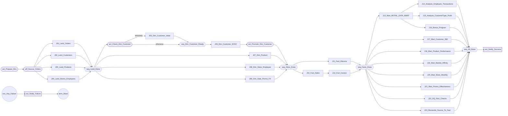

# Retail DW pipeline - step inventory

*Generated by `pipeline/generate.py` - do not edit by hand.*

**266 parallel-job stages** in **23 jobs**, plus **36 sequence activities** in the master
sequence = **302 steps**, connected by 247 links.

## Stage mix

| Stage type | Count |
|---|---|
| Sequential File (read) | 50 |
| Transformer | 49 |
| Sequential File (write) | 42 |
| Filter | 28 |
| Aggregator | 25 |
| Join | 25 |
| Copy | 17 |
| Sort | 16 |
| Remove Duplicates | 7 |
| Head | 5 |
| Funnel | 2 |

## Jobs

| Job | Layer | Stages | Reads | Writes |
|---|---|---|---|---|
| J01_Land_Orders | 1_Land | 13 | orders_raw.csv | stg_orders.csv, rej_orders.csv, dq_order_anomalies.csv, audit_land_orders.csv |
| J02_Land_Customers | 1_Land | 8 | customers_snapshot_2010.csv, customers_snapshot_2011.csv | stg_customers_2010.csv, stg_customers_2011.csv |
| J03_Land_Products | 1_Land | 11 | products_catalog.csv, suppliers.csv | stg_products.csv, stg_active_products.csv |
| J04_Land_Stores_Employees | 1_Land | 9 | stores.csv, employees.csv | stg_stores.csv, stg_employees.csv |
| J05_Dim_Customer_Initial | 2_Dimensions | 4 | stg_customers_2010.csv | dim_customer.csv |
| J06_Dim_Customer_SCD2 | 2_Dimensions | 20 | dim_customer.csv, stg_customers_2011.csv | dim_customer_next.csv, audit_scd2_customer.csv |
| J07_Dim_Product | 2_Dimensions | 9 | stg_products.csv | dim_product.csv, audit_products_by_category.csv |
| J08_Dim_Store_Employee | 2_Dimensions | 9 | stg_stores.csv, stg_employees.csv | dim_store.csv, dim_employee.csv |
| J09_Dim_Date_Promo_FX | 2_Dimensions | 11 | calendar.csv, promotions.csv, fx_rates.csv, country_currency.csv | dim_date.csv, dim_promotion.csv, dim_fx.csv |
| J10_Fact_Sales | 3_Facts | 25 | stg_orders.csv, dim_customer.csv, dim_product.csv, dim_store.csv, dim_employee.csv, dim_fx.csv | fact_sales.csv, dq_orphan_products.csv, audit_fact_by_month.csv |
| J11_Fact_Returns | 3_Facts | 15 | stg_orders.csv, dim_product.csv, dim_customer.csv | fact_returns.csv, audit_returns_by_category.csv |
| J12_Fact_Invoice | 3_Facts | 5 | fact_sales.csv | fact_invoice.csv |
| J13_Mart_RETAIL_DATA_MART | 4_Marts | 11 | fact_sales.csv, dim_customer.csv, dim_product.csv, dim_store.csv | RETAIL_DATA_MART.csv |
| J14_Analysis_Employee_Transactions | 4_Marts | 10 | RETAIL_DATA_MART.csv, dim_employee.csv | Q1_Employee_Transactions.csv, Q1_Top10_Employees.csv |
| J15_Analysis_CustomerType_Profit | 4_Marts | 7 | RETAIL_DATA_MART.csv | Q2_CustomerType_Profit.csv, Q2_Winning_CustomerType.csv |
| J16_Bonus_Program | 4_Marts | 12 | RETAIL_DATA_MART.csv, dim_customer.csv | Q3_Bonus_Program.csv, Q3_Bonus_Summary.csv |
| J17_Mart_Customer_360 | 4_Marts | 18 | fact_invoice.csv, fact_returns.csv, dim_customer.csv | Customer_360.csv, Customer_Segments.csv |
| J18_Mart_Product_Performance | 4_Marts | 14 | fact_sales.csv, fact_returns.csv, dim_product.csv | Product_Performance.csv, Product_Top50.csv |
| J19_Mart_Basket_Affinity | 4_Marts | 13 | fact_sales.csv | Basket_Affinity.csv |
| J20_Mart_Store_Monthly | 4_Marts | 7 | fact_sales.csv, dim_store.csv | Store_Monthly.csv |
| J21_Mart_Promo_Effectiveness | 4_Marts | 8 | fact_sales.csv, dim_promotion.csv | Promo_Effectiveness.csv |
| J22_DQ_Fact_Checks | 5_DataQuality | 17 | fact_sales.csv | dq_fact_checks.csv |
| J23_Reconcile_Source_To_Fact | 5_DataQuality | 10 | stg_orders.csv, fact_sales.csv | audit_reconciliation.csv |

## Master sequence (`Seq_Retail_DW_Master`)

