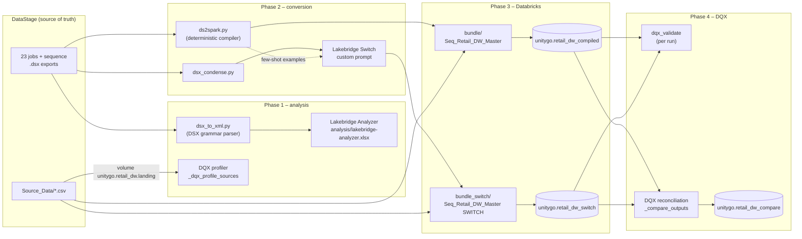

# Retail DW: DataStage → Databricks migration

This folder migrates the 23-job DataStage retail warehouse pipeline (`pipeline/`, exported to
`DataStage Jobs/Pipeline/*.dsx`) to Databricks.

It covers **the tools and terms used** (§0), **what was built** (design), **how we got there** (the
journey, including the dead ends) and **what is still open**.

---

## 0. Background: the pieces and the terms

### The source

- **IBM DataStage**: the ETL tool the pipeline was written for. A *parallel job* is a data flow of
  *stages* (file read, Transformer, Join, Aggregator, …) connected by *links*. A *sequence job* orchestrates
  parallel jobs. This repo's jobs were generated by `pipeline/generate.py` and exported as **DSX**, DataStage's
  text export format. Databricks tools expect the other export format, **XML**.

### The Databricks Labs tools

- **[Lakebridge](https://databrickslabs.github.io/lakebridge/)** ([repo](https://github.com/databrickslabs/lakebridge))
  is Databricks Labs' migration toolkit. We used three of its parts:
  - **[Analyzer](https://databrickslabs.github.io/lakebridge/docs/assessment/analyzer/)**: reads the source
    exports and produces an Excel assessment (jobs, stages, complexity, functions used). Pre-migration analysis.
  - **[BladeBridge](https://databrickslabs.github.io/lakebridge/docs/transpile/pluggable_transpilers/bladebridge/)**:
    Lakebridge's rule-based *transpiler*, a code converter. For DataStage it is meant to turn each XML-exported
    job into a Databricks notebook and each sequence into a Workflow
    ([DataStage guide](https://databrickslabs.github.io/lakebridge/docs/transpile/source_systems/datastage/)).
    **For this repo it produced no notebooks** (§3).
  - **[Switch](https://databrickslabs.github.io/lakebridge/docs/transpile/pluggable_transpilers/switch/)**:
    Lakebridge's *LLM-based* transpiler (experimental). It uploads the source files and runs a Databricks Job that
    sends each file to a Foundation Model with a conversion prompt, then writes the generated notebooks to the
    workspace. The prompt can be replaced with a
    [custom prompt](https://databrickslabs.github.io/lakebridge/docs/transpile/pluggable_transpilers/switch/customizing_switch/),
    which is what made it work here.
- **[DQX](https://databrickslabs.github.io/dqx/)** ([repo](https://github.com/databrickslabs/dqx)) is Databricks
  Labs' data-quality framework for PySpark. Rules ("checks") are declared as metadata and applied by a `DQEngine`.
  Failing rows are reported in `_errors` / `_warnings` columns or quarantined, and
  [summary metrics](https://databrickslabs.github.io/dqx/docs/guide/summary_metrics/) are written to a table.
  We used it three times: to [profile](https://databrickslabs.github.io/dqx/docs/guide/data_profiling/) the
  source files, to [validate](https://databrickslabs.github.io/dqx/docs/guide/quality_checks_apply/) each
  migrated run, and to reconcile the two implementations
  ([`compare_datasets`, `has_valid_schema`](https://databrickslabs.github.io/dqx/docs/reference/quality_checks/)).

### The Databricks platform pieces

- **[Declarative Automation Bundles](https://docs.databricks.com/dev-tools/bundles/)** (Asset Bundles):
  `databricks.yml` + resource YAML that deploys notebooks and jobs with `databricks bundle deploy`.
- **[Lakeflow Jobs](https://docs.databricks.com/aws/en/jobs/)**: the scheduler/orchestrator that replaces the
  DataStage sequence (tasks, dependencies, condition tasks).
- **[Unity Catalog](https://docs.databricks.com/aws/en/data-governance/unity-catalog/)**: tables live in
  `catalog.schema.table`, and the source CSVs sit in a
  [volume](https://docs.databricks.com/aws/en/volumes/) (`/Volumes/unitygo/retail_dw/landing`).

### Terms used in this doc

| Term | Meaning |
|---|---|
| **compiler**, **compiled version** | `ds2spark.py`, written for this migration because BladeBridge produced nothing. It is not a Lakebridge tool. It reads the job definitions in `pipeline/pipeline_def.py` (the model that also generates the DSX) and emits one Databricks notebook per job by fixed rules (§2.1, §2.3). Same input, same output, every time. |
| **Switch version** | The notebooks Switch generated from the DSX exports, using our custom prompt. |
| **SDP version** | A third implementation: Switch with `target_type: sdp` generated one [Spark Declarative Pipeline](https://docs.databricks.com/aws/en/dlt/) source file per job, all deployed as **one** pipeline. SCD2 is done with Auto CDC from snapshots (§7). |
| **two implementations** | The compiled and Switch versions were both deployed and run, each to its own schema, so each could be checked against the other with DQX. The rule-based and LLM routes are both kept: the compiled version is the deterministic reference, and the Switch version shows what Lakebridge's supported tool produces. |
| **validation** | DQX rules on the migrated tables of *one* run (not-null, uniqueness, value ranges, foreign keys …), §5. |
| **reconciliation** | DQX check that the Switch run's tables equal the compiled run's tables, row for row, §6. |

---

## 1. Outcome

| | |
|---|---|
| Source | 23 parallel jobs + 1 master sequence (`Seq_Retail_DW_Master`), 266 stages + 36 sequence activities (see `PIPELINE.md`) |
| Target | Databricks Asset Bundle: one Lakeflow Job (28 tasks), 23 job notebooks + 5 support notebooks, Delta tables in Unity Catalog |
| Workspace / catalog | Azure Databricks workspace (CLI profile `DEFAULT`), catalog `unitygo` |
| Implementations | Three, run side by side (see §0):<br>• **compiled** – our rule-based compiler `ds2spark.py` → `unitygo.retail_dw_compiled`<br>• **Switch** – Lakebridge Switch (LLM) with our custom prompt → `unitygo.retail_dw_switch`<br>• **SDP** – Switch with `target_type: sdp` → one Spark Declarative Pipeline → `unitygo.retail_dw_sdp` (§7) |
| Pipeline runs | Both: 27/27 tasks succeed (J05 is correctly *excluded* when `dim_customer` already exists) |
| DQX validation | 19 tables, 66 rules (60 error / 6 warn): **0 error-level violations** in both; identical warnings |
| DQX reconciliation | Switch vs compiled, 39 tables / 109,687 rows: **39/39 match**, 0 schema, row or surrogate-key differences<br>SDP vs compiled: **37/39 match**; the 2 differences are explained and are not SDP defects (§7) |

Final runs (job run ids):

| Run | Id | Result |
|---|---|---|
| Compiled pipeline | `636922528054694` | SUCCESS, validation clean |
| Switch pipeline | `698138070632909` | SUCCESS, validation clean |
| DQX reconciliation | `272420992913954` | 39/39 match (326 s) |
| DQX reconciliation (with the "optimisation" changes) | `157986346301460` | 39/39 match (566 s – **slower**, see §8) |
| SDP end-to-end (pipeline → DQX validate → DQX compare) | `1120547313076486` | SUCCESS, validation clean, 37/39 match |

---

## 2. Architecture



### 2.1 Mapping DataStage to Databricks

| DataStage | Databricks |
|---|---|
| Parallel job | One Python notebook (`src/notebooks/Jxx_*.py`) |
| Link | One temp view named like the link, built with `spark.sql(...)` |
| Sequential File source, `#pSrcDir#/*.csv` | `spark.read.csv` from the UC volume `unitygo.retail_dw.landing`, **columns renamed by position**, empty strings preserved (§4) |
| Sequential File target or intermediate file (`#pStgDir#`, `#pDwhDir#`, `#pMartDir#`, `#pAuditDir#`) | Delta table `{catalog}.{schema}.<file stem>` (overwrite; append where the stage appends) |
| Transformer derivation | `SELECT CAST(<expr> AS <type>)`, with expressions translated (§2.3) |
| Filter / Join / Aggregator / Sort / Remove Dups / Head / Copy / Funnel | `WHERE` / `JOIN` / `GROUP BY` / `ORDER BY` / `row_number()=1` / `ORDER BY … LIMIT` / extra view / `UNION ALL` |
| Surrogate-key idiom `@PARTITIONNUM + (@NUMPARTITIONS * (@INROWNUM-1)) + 1` | `row_number() OVER (ORDER BY <upstream sort>)` |
| Job parameters | Notebook widgets `catalog`, `schema`, `src_dir`, `pRunDate`, `pEffDate` |

### 2.2 Mapping the master sequence to a Lakeflow Job

`build_bundle.py` generates `resources/retail_dw_job.yml` from `pipeline/pipeline_dag.json`.

| Sequence activity | Job task |
|---|---|
| `act_Prepare_Dirs` + `wff_Source_Orders` | `setup` notebook: creates the schema and waits up to 10 min for the 11 source files |
| `run_Jxx` job activities | `notebook_task` per job |
| `seq_*` sequencers (ALL) | Folded into `depends_on` |
| `act_Check_Dim_Customer` (exec: file exists?) | `check_dim_customer` notebook → task value `dim_state` |
| `run_J05` with custom trigger `= "MISSING"` | `condition_task` `cond_dim_missing` → J05 runs on `true` |
| `seq_Dim_Customer_Ready` (ANY) | J06 `run_if: NONE_FAILED`, depends on J05 and the check |
| `act_Promote_Dim_Customer` (`mv` file) | `promote_dim_customer`: `CREATE OR REPLACE TABLE dim_customer AS SELECT * FROM dim_customer_next` |
| `seq_All_Done` | `dqx_validate` (depends on J14–J23) |
| `exc_Any_Failure`, `act_Notify_*`, `term_Abort` | **Not migrated.** No job notifications are configured yet (§8) |

### 2.3 Expression translation (`ds2spark.py`)

A recursive-descent parser translates DataStage expressions into Spark SQL. It handles
`If … Then … Else` → `CASE`, `And`/`Or`, the `:` concatenation operator, and these functions:
`Trim, Upcase, Downcase, Len, Abs, Left, NullToValue, IsNull, Ereplace, CRC32, StringToDecimal,
StringToDate, StringToTimestamp, DateToString, TimestampToString, DaysSinceFromDate, DateFromDaysSince`.
Date formats are mapped too (`%yyyy%mm%dd` → `yyyyMMdd`, `%nn` → minutes). An unknown function raises an
error instead of being passed through silently.

---

## 3. Journey

### Phase 1: analysis

1. **DSX to XML.** The Lakebridge Analyzer and BladeBridge read only DataStage *XML* exports. The repo only had
   DSX, and no DataStage server was available to re-export. `dsx_to_xml.py` started as a line-based converter.
   It was then rewritten as a tokenizer/parser that follows the DSX grammar from
   [jdelvign/dsxparser](https://github.com/jdelvign/dsxparser) (`DSX.g4`). The rewrite keeps every block
   (`DSJOB`, `DSSTAGETYPES`, `DSTABLEDEFS`, `DSROUTINES`, `DSSHAREDCONTAINER`, `DSUBINARY`); the first version
   dropped everything except `DSJOB`.
2. **Lakebridge Analyzer** (`bladespector`, run on the XML) → `analysis/lakebridge-analyzer.xlsx`:
   24 jobs, 946 nodes. Complexity: **VERY_HIGH** 5 (J06 SCD2, J10 Fact Sales, J17 Customer 360,
   J22 DQ checks, the master sequence), **HIGH** 17, **MEDIUM** 2 (J05, J12). Marked *supported*:
   Sequential File, Filter, Join, Aggregator, Copy, Sort, Remove Duplicates, Funnel, Job Activity, Sequencer.
   Marked *not supported*: `CTransformerStage` and `CCustomStage` (even though the Lakebridge docs list
   Transformer as supported), plus the exec-command, notify, wait-for-file, terminator and exception-handler
   activities.
3. **DQX source profiling** (`_dqx_profile_sources`): `DQProfiler` + `DQGenerator` over the 11 source CSVs,
   from 12 rows (suppliers) to 33,732 rows (orders). Candidate rules: 2–23 per file. Results are in
   `unitygo.retail_dw.dq_source_profile`. The candidates are not applied as-is. The validation rules (§5) were
   written by hand from the DataStage job logic, and the candidates are kept for review.

### Phase 2: conversion

| Attempt | Result |
|---|---|
| **BladeBridge** (Lakebridge's DataStage transpiler, pip `databricks-bb-plugin`, binary run directly) | Parses the XML (finds the job, nodes and links) but generates **no notebooks**. Its only output is `databricks_conversion_supplements.py`. Same result for: all 24 pipeline jobs, the repo's original real export (`RETAIL_DATA_MART_Job.dsx`), six genuine IBM-authored DataStage 8.5 sample jobs ([IBM XML-stage examples](https://www.ibm.com/support/pages/infosphere-datastage-example-files-xml-transformation)), PYSPARK and SPARKSQL targets, the configs named in the converter README, and the grammar-faithful XML. The official `lakebridge transpile` CLI fails with `Client has not yet registered its transpile capability`. **Resolved later (§8a):** our XML was at fault, not the tool. With genuine Designer exports BladeBridge converts offline, and after fixing our DSX → XML converter it converts our pipeline jobs too. |
| **Compiler** (`ds2spark.py`, see §0) | Reads the in-memory job model (`pipeline/pipeline_def.py`, the same model that generates the DSX). Deterministic. Became the reference implementation. |
| **Switch #1**, built-in `unknown_etl` prompt | 24/24 "converted" with no errors, but produced [Spark Declarative Pipeline](https://docs.databricks.com/aws/en/dlt/) code: only 1 of 24 files had `@dp` decorators, references to tables that are never created, Windows paths left in, and an invented master-sequence notebook. **Unusable.** |
| **Switch #2**, custom notebook prompt + few-shots | Usable. Matched the compiled version structurally (same 208 views, reads and writes in all 23 jobs). 170/208 views had identical normalised SQL. **4 real defects:** a `LIMIT` lost its upstream `ORDER BY` (wrong Top-N in J14, J16, J18, J19). |
| **Switch #3**, improved prompt + adaptive thinking | 0 lost `ORDER BY`, 11/11 CSV reads mapped by position. The remaining 56 SQL differences were all classified as cosmetic. (The first attempt failed outright: `thinking.type: enabled` is rejected by `databricks-claude-sonnet-5-5`, which needs `{"type": "adaptive"}` + `output_config.effort`.) |
| **Switch #4**, adds the empty-field rule (§4) | Final version in `bundle_switch/`. 23/23 converted, 526k tokens. |

Switch input: raw DSX is 100–400 KB per job and exceeds Switch's token threshold.
`dsx_condense.py` renders each job from the DSX itself as a compact text description (parameters, stages,
properties, links, columns, derivations), at most 42k characters (about 12.4k tokens) per job. An excerpt
(`switch_input/J05_Dim_Customer_Initial.txt`):

```text
STAGE xfm_Version1  [CTransformerStage]
    in  link lnk_stg  <-> src_stg_customers_2010
    out link lnk_v1  <-> srt_Dim_Customer
        col customer_sk sql=4 prec=10,0 nullable=0  := lnk_stg.customer_id * 1000 + 1
        col version_no sql=4 prec=10,0 nullable=0  := 1
```

### Switch prompts, attempt by attempt

Every attempt used model `databricks-claude-sonnet-5-5`, `source_format: generic` (no SQL preprocessing),
`target_type: notebook`, `max_fix_attempts: 1`, `concurrency: 4`, `--source-dialect unknown_etl`, and the
condensed inputs above. What changed between attempts is the prompt, the few-shot examples and `request_params`.
Each system message is kept in [`switch_prompt/history/`](switch_prompt/history/) so they can be diffed.
The final prompt (system message + few-shots) is
[`switch_prompt/datastage_to_notebook.yml`](switch_prompt/datastage_to_notebook.yml), generated by
[`build_prompt.py`](switch_prompt/build_prompt.py).

| # | Prompt | Few-shots | `request_params` | Tokens | Result |
|---|---|---|---|---|---|
| 1 | Built-in `etl_to_lakeflow_sdp/unknown_etl.yml` | – (built-in) | – | 282k | Unusable SDP code (see below) |
| 2 | Custom, [`system_attempt2.txt`](switch_prompt/history/system_attempt2.txt) | J05, J04 | – | 485k | Correct structure. 4 Top-N views lost `ORDER BY`; CSV columns read by name |
| – | Same as #3 | J04, J15 | `thinking: {type: enabled, budget_tokens: 16000}` | 0 | All 23 calls rejected: HTTP 400 `"thinking.type.enabled" is not supported for this model` |
| 3 | Custom, [`system_attempt3.txt`](switch_prompt/history/system_attempt3.txt) | J04, J15 | `thinking: {type: adaptive}`, `output_config: {effort: high}`, `max_tokens: 64000` | 523k | 0 lost `ORDER BY`, 11/11 positional reads. Empty-field bug still present (inherited from the compiler) |
| 4 | Custom, [`system_attempt4.txt`](switch_prompt/history/system_attempt4.txt) (final) | J04, J15 (regenerated) | as #3 | 526k | Matches the compiled version on 39/39 tables after running |

**Attempt #1, built-in `unknown_etl` prompt.** In Switch, `--source-dialect` picks a *prompt family*.
`unknown_etl` belongs to the `etl_to_lakeflow_sdp` family. Its system message begins *"Convert ETL workload code to
Lakeflow Spark Declarative Pipeline … code in `${language}`"*, and `${language}` is only filled in when
`target_type: sdp`. With `target_type: notebook` the model got the SDP instructions with the placeholder left in,
and said so in its output ("The `${language}` placeholder in the request was not filled in"). It wrote functions
without `@dp` decorators, guessed the master sequence's logic from job names, and kept the Windows paths.
*Lesson: for plain notebooks from an ETL source that isn't built in, provide your own prompt through
`conversion_prompt_yaml`.*

**Attempt #2, first custom prompt** ([full text](switch_prompt/history/system_attempt2.txt)). Its sections:

1. *Input and Output*: the input is one condensed job. The output is plain batch-notebook Python. It
   explicitly forbids `dp.table` / `pyspark.pipelines`, and says "never invent logic".
2. *Parameters*: the **exact** widget block to start with, plus how each DataStage directory parameter maps
   (`#pSrcDir#` → `src_dir`; other directories → Delta tables).
3. *Stages → code*: one rule per stage type (source, target, Transformer, Filter, Join, Aggregator, Sort, Remove
   Duplicates, Head, Copy, Funnel, surrogate-key idiom), the column-type mapping, and "one temp view per
   link, named like the link".
4. *DataStage functions → Spark SQL*: the same mapping table the compiler uses, including date-format tokens.
5. *Style*: no SparkSession, a comment per stage, row counts after writes.

Few-shots: two (condensed job → compiled notebook) pairs. Effect: the declarative-pipeline output disappeared,
along with the `C:/` paths and the invented logic. All 23 notebooks had the same views, reads and writes as the
compiled version. Two problems remained:
- *Head after Sort lost the order.* The rule said `Head: LIMIT n`, and neither example contained a Sort feeding
  a Head. So `Top 50 products` became an arbitrary 50.
- *CSV columns read by name.* The examples showed the compiler's by-name read, which was itself a bug. Switch copied it.

**Attempt #3, three changes made together** ([full text](switch_prompt/history/system_attempt3.txt);
diff against #2: `diff switch_prompt/history/system_attempt{2,3}.txt`):

```text
+ DataStage maps file columns BY POSITION, never by header text (headers in the file may differ from the job's
+ column names). So: assert the column count equals the link's column count, rename with .toDF(<link column
+ names in order>), ...
+ ROW ORDER (critical): Spark views do NOT keep row order. A DataStage Sort's order flows to every downstream stage
+ until a Join, Aggregator or Funnel breaks it (it passes through Copy, Filter and Transformer). Track it, and:
+   - Head: emit `ORDER BY <the upstream sort keys> LIMIT n` - the first n rows in sort order.
+ # Self-check before answering
+ 1. Every link in the input has exactly one view (or table write), named like the link.
+ 2. Every `LIMIT` that has a Sort upstream (through Copy/Filter/Transformer) carries that Sort's `ORDER BY`.
+ 3. Every CSV source is renamed by position with .toDF(...) and has the column-count assert.
+ 4. Every output view selects exactly the output link's columns, in the link's order, with the declared types.
+ 5. No logic, column or table appears that the input does not contain.
```

- **Few-shots swapped** to J04 (CSV sources, which shows the positional read) and J15 (Sort → Copy → Head, which shows
  the order surviving a Copy). The compiler was fixed first, so the examples were correct.
- **Adaptive thinking** at high effort. The fixed thinking budget documented in Switch's
  [LLM configuration](https://databrickslabs.github.io/lakebridge/docs/transpile/pluggable_transpilers/switch/customizing_switch/)
  is rejected by this model.

Result: 4 → 0 lost `ORDER BY`, 0 → 11 of 11 positional reads, for 8% more tokens. The three changes were made
together, so we can't say which one did the work.

**Attempt #4, one rule for one bug found at run time** ([full text](switch_prompt/history/system_attempt4.txt)).
DQX validation found 9,269 NULL `customer_id` (§4 #2). The compiler was fixed, the examples regenerated, and this was added:

```text
+ EMPTY FIELDS: Spark reads an empty CSV field as NULL, DataStage reads it as "" for a non-nullable string column.
+ Wrap every non-nullable string source column in coalesce(`col`, '') - otherwise checks such as
+ `Len(Trim(x)) = 0` never fire (Len of NULL is NULL).
  (self-check 3 extended: "... and its non-nullable string columns are wrapped in coalesce(`col`, '')")
```

Result: 50 `coalesce` wraps, the same count as the compiler. 0 validation errors and 39/39 tables matching after the run.

**What carries over to other migrations:**

1. **Choose the prompt family deliberately.** The dialect decides the output style (notebook, SQL or SDP) as much
   as `target_type` does.
2. **Give the exact skeleton** (widget block, naming rule "one view per link, named like the link"). It removed
   parameter and path drift in one step, and makes outputs diffable against a reference.
3. **Few-shots outweigh rules.** Switch copied a bug from the examples in spite of the rules. Choose examples that
   contain the hard patterns (Sort → Copy → Head, CSV reads), and make sure the examples are correct.
4. **Write down the source platform's behaviour.** The model defaults to Spark's, which differs from DataStage on
   column mapping, empty strings and row order. Each of those needed an explicit rule.
5. **End with a self-check list** naming the defects you have seen. It costs little, and the defects it lists didn't come back.
6. **Condense the input.** Raw DSX is mostly repeated schema. The condensed job is 4–10× smaller (about 9× for
   most jobs) and keeps all derivations.
7. **Measure every generation**: a static diff against a reference (`compare_notebooks.py`), then a run, then
   DQX. Several defects only appeared at run time (#4).

### Phase 3: run on Databricks, where the real bugs appeared

Running both versions against real data exposed DataStage semantics that neither the compiler nor the LLM
had reproduced. DQX caught them. See §4.

### Phase 4: validation and reconciliation

Covered in §5 and §6.

### Phase 5: SDP version

Switch's `target_type: sdp`, with SCD2 rebuilt on Auto CDC. Covered in §7.

---

## 4. DataStage semantics that had to be reproduced

These four issues were each found by running the pipeline or by DQX, not by reading the code. They apply to
both implementations. The Switch prompt now spells out each one.

| # | DataStage behaviour | Naive Spark behaviour | Symptom | Fix |
|---|---|---|---|---|
| 1 | Sequential File maps columns **by position**; the header text is ignored | `spark.read.csv(header=true)` + select by name | J03 failed: `UNRESOLVED_COLUMN SupplierCountry` (the file header says `Country`) | Assert the column count, then `.toDF(<declared names>)` |
| 2 | An empty field in a **non-nullable string** column is `""` | Empty CSV field → `NULL` | `If Len(Trim(CustomerID)) = 0` never fired, so 9,269 order lines had `customer_id NULL` and **`is_guest = 0` on every row**. DQX `is_not_null` caught it | `coalesce(col, '')` on non-nullable source string columns |
| 3 | A Sort's order flows through Copy/Filter/Transformer into a Head (first *n* rows in sort order) | Temp views do not keep order; a bare `LIMIT` returns arbitrary rows | Switch #2 produced wrong Top-N marts | `ORDER BY <upstream sort keys> LIMIT n` |
| 4 | Surrogate keys numbered by input row order (`@INROWNUM`) | No inherent row order | `store_sk`, `employee_sk`, `promo_sk` are only as deterministic as the file read order | `row_number() OVER (ORDER BY …)`. Reconciliation treats these keys as warnings (§6) |

---

## 5. DQX validation (`_dqx_validate`, last task of each run)

- **Rules:** 66 metadata rules on 19 tables (60 error, 6 warn): not-null, uniqueness of grain, allowed values,
  SCD2 invariants (`eff_start_key <= eff_end_key`, an open-ended current row), measure signs, foreign keys from
  facts to dimensions, RFM score ranges, and `audit_reconciliation.status = 'PASS'` (DataStage J23).
- **Run:** `DQEngine.validate_checks` first, then `apply_checks_by_metadata`. Results go to
  `<schema>.dq_validation_results` and failing rows to `<schema>.dq_quarantine_<table>`. The task fails the job
  on any error-level violation.
- **Final result (all three schemas: compiled, Switch, SDP):** 0 errors. Warnings, which are expected data conditions:

  | Table | Rule | Rows |
  |---|---|---|
  | fact_sales | guest_customer (customer_sk = -1) | 9,106 |
  | fact_sales | gross_profit_not_negative | 934 |
  | fact_sales | zero_price_line | 87 |
  | fact_invoice | zero_value_invoice | 44 |
  | fact_sales | orphan_product | 12 |

- **Rule corrections made along the way:** `sales_amount > 0` and `invoice_sales > 0` were too strict.
  DataStage J01 deliberately keeps zero-price lines, so these became `>= 0` (error) plus a `> 0` warning.
  Also, DQX ≥ 0.16 reads a bare string in `is_in_list(allowed=…)` as a *column*, so literals are now quoted (`'UK'`).

## 6. DQX reconciliation: Switch vs compiled (`_compare_outputs`)

The Switch output is the dataset under check; the compiled output is the reference. Everything is DQX-native:

1. One rule set per table, stored in DQX checks storage (`TableChecksStorageConfig`, table
   `unitygo.retail_dw_compare.dq_compare_checks`, `run_config_name` = table name):

   | Rule | DQX function | Severity |
   |---|---|---|
   | `schema_matches` | `has_valid_schema(ref_table, strict=True)`: same columns, order and types | error |
   | `rows_match` | `compare_datasets` on the table's natural key, `check_missing_records`, excluding input-order surrogate keys | error |
   | `surrogate_keys_match` | `compare_datasets` including `store_sk` / `employee_sk` / `promo_sk` | warn |

2. `DQEngine.apply_checks_and_save_in_tables` with one `RunConfig` per table. A `DQMetricsObserver` writes summary
   metrics to `dq_compare_metrics`. Only tables that differ are re-run with a quarantine config
   (`<table>_dq_quarantine`).
3. The report is read from DQX's per-check metrics (`check_metrics.error_count` / `warning_count`).

**Result:** 39/39 tables match. `checked_count` equals the input row count (for example, 32,575 for
`fact_sales`), so the checks really ran. A separate `EXCEPT ALL` on `fact_sales`, `dim_store` and
`product_top50` agrees: 0 differences.

Caveat: the Switch prompt uses compiled notebooks as few-shot examples, so the two implementations are
not fully independent. Agreement shows that Switch reproduced the compiler's semantics. It does not prove
the semantics independently. Validation against DataStage itself would need DataStage output for
the same inputs (see §8).

### Static comparison of notebooks (`compare_notebooks.py`)

Before running, each Switch generation was compared view by view against the compiled notebooks:

| Metric | Switch #2 | Switch #3 | Switch #4 |
|---|---|---|---|
| Views with identical normalised SQL | 170/208 | 152/208 | 152/208 |
| `LIMIT` that lost its `ORDER BY` | 4 | 0 | 0 |
| CSV reads mapped by position | 0/11 | 11/11 | 11/11 |
| Non-nullable source strings wrapped in `coalesce` | – | – | 50 (compiled: 50) |

## 7. SDP version (Switch `target_type: sdp`)

The notebook versions keep DataStage's shape: one job notebook per parallel job, and a Lakeflow Job that
replays the master sequence. The SDP version keeps the *logic* but uses what
[Spark Declarative Pipelines](https://docs.databricks.com/aws/en/dlt/) provide: one pipeline whose
dependency graph replaces the sequence, and Auto CDC in place of the hand-written SCD2.

### 7.1 Design

| DataStage | SDP version |
|---|---|
| 23 job notebooks + 28-task Lakeflow Job | **One** pipeline (`bundle_sdp/resources/retail_dw_sdp.pipeline.yml`) with 21 source files. The run order comes from the dataflow, so `setup`, `check_dim_customer`, `cond_dim_missing` and `promote_dim_customer` are gone |
| Link | `@dp.temporary_view` named `<job code>_<link>` (e.g. `j04_lnk_stores`). Dataset names are pipeline-wide, and the same link names recur across jobs |
| Target file | `@dp.materialized_view` with the same name as the file, so DQX validation and reconciliation run unchanged |
| Job parameters | Pipeline `configuration` (`src_dir`, `pRunDate`, `pEffDate`) read with `spark.conf.get` |
| J02 + J05 + J06 + check + promote (customer SCD2) | One **dimension unit** (`J02_J05_J06_Dim_Customer_Unit.py`), see below |

**SCD2 with Auto CDC from snapshots.** In DataStage, SCD2 takes a 20-stage job (J06), a conditional
initial-load job (J05), an "exists?" check and a file-move promote step. The Analyzer rates J06 VERY_HIGH, and
re-runs apply the 2011 snapshot again (§8). Switch generated this design:

```python
dp.create_streaming_table(name="dim_customer_history")

def next_snapshot_and_version(latest_version):      # 2010 = version 1, 2011 = version 2
    if latest_version is None: return (staged_snapshot(2010), 1)
    if latest_version == 1:    return (staged_snapshot(2011), 2)
    return None

dp.create_auto_cdc_from_snapshot_flow(target="dim_customer_history", source=next_snapshot_and_version,
    keys=["customer_id"], stored_as_scd_type=2, track_history_column_list=["attr_hash"])
```

`staged_snapshot(year)` is J02's standardisation (positional read, `coalesce`, trims, CRC32 `attr_hash`). It is
a plain function, so the CDC flow never depends on a pipeline dataset, and the `stg_customers_*` materialized
views use the same function. Tracking history on `attr_hash` reproduces DataStage's change test exactly.
`dim_customer` / `dim_customer_next` are materialized views over the history table, which recompute
DataStage's columns from `__START_AT` / `__END_AT`: `version_no = row_number() OVER (PARTITION BY customer_id ORDER BY __START_AT)`,
`customer_sk = customer_id * 1000 + version_no`, `eff_start_key` 19000101 or `pEffDate`, `eff_end_key` 99991231
or `pEffDate − 1`, and `is_current`. Auto CDC remembers which snapshot versions it has processed, so a re-run
doesn't apply 2011 again.

### 7.2 Prompt and runs

Prompt: [`switch_prompt/datastage_to_sdp.yml`](switch_prompt/datastage_to_sdp.yml), built by
[`build_prompt_sdp.py`](switch_prompt/build_prompt_sdp.py). Config: [`switch_config_sdp.yml`](switch_config_sdp.yml)
(`target_type: sdp`, `sdp_language: python`). The stage, function and DataStage-semantics rules are the notebook
prompt's (§3, §4). New in this prompt:

- **The output shape**, as above: modern API only (`@dp.temporary_view`, `@dp.materialized_view`,
  `spark.read.table`), no `dbutils`, writes, actions or qualified names.
- **Switch's built-in SDP guidance is left out on purpose.** The prompt does not reference
  `${common_sdp_instructions_and_guidelines}`. That guidance uses legacy APIs (`@dp.view`, `dp.read`), forbids the
  `spark.sql` this translation relies on, and asks for hard-coded `catalog.schema.table` names. Switch combines the
  prompts by OmegaConf substitution, so leaving the placeholder out removes the guidance completely.
- **An "SCD Type 2 dimension unit" rule**, without an example: don't translate expire/carry/insert/promote stage
  by stage. Stage the snapshots in a plain function, add a history streaming table and
  `create_auto_cdc_from_snapshot_flow` with a version callback, and derive the target files from `__START_AT` /
  `__END_AT` using the jobs' own derivations.
- **Few-shots:** J04 and J15 rendered by a new `ds2spark.py --sdp` mode (`sdp_reference/`). That mode emits the
  same translation as SDP. Before Switch ran, it was deployed for J01 + J04 and the pipeline completed with the
  same row counts as the compiled version, which confirmed the pattern works.
- **Input:** the 20 single-job files plus one dimension unit (`switch_input_sdp/J02_J05_J06_Dim_Customer_Unit.txt`).
  The unit is the three condensed jobs plus a short header that states the sequence's orchestration (initial
  load only if the dimension is missing, apply 2011, promote). That header is written by hand; it summarises
  `pipeline_dag.json`, because this information exists only in the sequence.

| Run | What | Result |
|---|---|---|
| Switch `70464911684866` | 21 files, `max_fix_attempts: 1` | 21/21 converted (185k tokens). **Every** file reported the same SDP validation error (`DataflowGraph.validate.Unresolved`), even J01, which has no dependencies. Switch validates each file in a throwaway pipeline that has none of our `configuration`. Its fix-up step then "repaired" every file by inventing `src_dir` defaults such as `/Volumes/main/default/source_data` |
| E2E `334701512237490` | Pipeline → DQX validate → DQX compare | Pipeline **succeeded first time**, validation clean. Compare: 25/39. `dim_customer_next` (SCD2 output) matched **exactly**, but `dim_customer` had 94 rows instead of 948, and 12 downstream tables followed |
| Switch `533534559691383` | Customer unit only, prompt clarified, `max_fix_attempts: 0` | `dim_customer` and `dim_customer_next` both built from the post-snapshot state. No invented defaults |
| E2E `1120547313076486` | As above | Pipeline + validation SUCCESS, **37/39 match** |

The prompt fix after the first E2E run: *"Downstream jobs read the dimension AFTER the orchestration has
run, i.e. after every snapshot has been applied and the 'next' file promoted - so the dimension and its 'next'
file have the SAME content … never just the initial load."* The first wording ("materialized views with the
names of the dimension's target files") let Switch map the J05 output to `dim_customer` literally.

### 7.3 Result and the two remaining differences

DQX validation of `retail_dw_sdp` gives the same result as the compiled version: 0 errors, and the same five
warnings with the same counts. Reconciliation against `retail_dw_compiled`: **37/39 tables match**,
`dim_customer_history` exists only in SDP (by design), and two tables differ:

| Table | Difference | Cause | Verdict |
|---|---|---|---|
| `audit_scd2_customer` | Compiled: `U` 935. SDP: `N` 841, `C` 13, `U` 81 | The **compiled reference** comes from repeated runs. Once `dim_customer` exists, J05 is skipped and J06 compares 2011 with an already-2011 dimension, so everything is "unchanged". SDP reports the correct first-load counts and keeps them on re-runs | Reference artefact, not an SDP defect. To compare like with like, the compiled reference needs a clean first run (drop its customer-dimension tables, then re-run) |
| `basket_affinity` | 128 rows | J19 keeps the top 1,000 pairs sorted **only** by `pair_count`. The 876 pairs above the cutoff (`pair_count` > 14) are identical. 124 of the pairs tied at 14 are kept, and which 124 is undefined, both in DataStage and in either Spark version | Non-determinism inherited from the source. A tie-break key in J19 would make it testable |

### 7.4 What we learned

1. **The SCD2 pattern converts well.** Given a rule but no example, Switch produced a correct
   Auto-CDC-from-snapshot design whose output equals the hand-written 20-stage job, and it fixes the re-run problem.
2. **Hand the LLM the orchestration context.** The SCD2 semantics live partly in the sequence (initial-load
   condition, promote). Sending the jobs as one unit with that context was needed, and the one ambiguous sentence
   about promote was the one real defect.
3. **Switch's SDP validation runs without your pipeline configuration.** If files read `spark.conf`, expect it to
   fail on every file. Set `max_fix_attempts: 0`, or the fix-up step invents defaults. The 20 single-job files
   in `bundle_sdp/` come from the first run and still contain these defaults. They are harmless because the
   pipeline configuration takes precedence, but they would hide a missing configuration, so regenerate them with
   `max_fix_attempts: 0` before production use.
4. **The real validation is a pipeline run plus DQX.** Here only a full pipeline update, followed by validation
   and reconciliation, gave a meaningful answer.
5. **Reconciliation exposed problems in the reference too:** the re-run state of the compiled SCD2, and a
   non-deterministic top-N in the source job.

---

## 8a. BladeBridge offline: converting DataStage XML exports directly

This is the supported Lakebridge route for DataStage (XML export → BladeBridge), run **fully offline**: no
Databricks CLI, login or workspace. `databricks labs lakebridge transpile` only wraps this converter. It needs a
workspace login to install, and here it still fails with `Client has not yet registered its transpile capability`.

### 8a.1 Setup

1. Download and unzip the BladeBridge wheel (`databricks_bb_plugin-0.3.0-py3-none-any.whl`) and, optionally, the
   Analyzer wheel (`databricks_bb_analyzer-0.3.1-py3-none-any.whl`). A wheel is a zip file.
2. **macOS:** files downloaded from the internet carry a quarantine flag, so macOS refuses to load the native
   libraries (`library load disallowed by system policy`). Clear it on the extracted folders only:
   `xattr -dr com.apple.quarantine databricks_bb_plugin-0.3.0-py3-none-any databricks_bb_analyzer-0.3.1-py3-none-any`
3. Use a Python version for which the wheel ships a pyarmor runtime (`hasher/<platform>/pyarmor_runtime_000000/pyXY/`).
   macOS arm64 has 3.10–3.14. Here the 3.13 runtime went missing after macOS rejected it on the first,
   quarantined, load, so 3.12 is used. Install the plugin's declared dependencies:
   ```bash
   uv venv -p 3.12 .bbvenv && uv pip install --python .bbvenv/bin/python \
     "databricks-labs-blueprint>=0.12,<0.13" "psutil>=7" "pygls>=2" "pyyaml>=6.0.2"
   ```

### 8a.2 Convert

[`run_dbxconv.py`](lakebridge_workflow/src/lakebridge_workflow/run_dbxconv.py), exposed as `lakebridge-workflow run-dbxconv`, calls the `dbxconv` binary once per XML file. This is a
literal lift-and-shift: stage-by-stage, no re-architecture (see §8b for the separate
optimization pass). The target defaults to **`DBSQL`**:

```bash
uv run --python 3.12 --with "$(ls -t migration/lakebridge_workflow/dist/*.whl | head -n 1)" \
  lakebridge-workflow run-dbxconv <extracted plugin dir> <dir of .xml> <output dir> DBSQL
#                                                                                      DBSQL | PYSPARK | SPARKSQL (default DBSQL)
```

| Target | Converter config | Output |
|---|---|---|
| `DBSQL` (default) | `datastage2dbsql.json` + `-M CodeGeneration::SQL` | Plain Databricks SQL script (`.sql`). Not offered by `lakebridge transpile`; documented in `Converter/Configs/Datastage/README.txt` |
| `PYSPARK` | `base_datastage2databricks_pyspark.json` | Databricks notebook (Python), DataFrame API, one cell per stage |
| `SPARKSQL` | `base_datastage2databricks_sparksql.json` | Databricks notebook (Python): one `spark.sql(...)` + temp view per stage |

Sequence jobs also produce a Databricks Workflow JSON. The raw command for one file, which is what the script does:

```bash
P=<extracted plugin dir>; C=$P/databricks/labs/bladebridge/Converter
mkdir -p work/originals work/out && cp job.xml work/originals/ && cd work      # out/ must exist beforehand
ARGS=("$C/bin/MacOS/dbxconv" DATASTAGE -u base_datastage2databricks_pyspark.json -n out -i originals/job.xml)
H=$(PYTHONPATH=$P ../.bbvenv/bin/python -c 'import sys; from databricks.labs.bladebridge.hasher import compute_hash; print(compute_hash(sys.argv[1:]))' "${ARGS[@]}")
BB_CONFIG_CONVERTER_DIR=$C/Configs UTF8_NOT_SUPPORTED=1 "${ARGS[@]}" -H "$H"
```

- `-H` is a handshake hash over the exact argument list. Only the wheel's hasher can compute it, so recompute it
  whenever the arguments change (adding `-v` for a verbose log, for example).
- Each run takes about 12–14 s, most of it the binary unpacking itself.
- Notebooks are written under `out/` following the job's DataStage `Category` folder path.

### 8a.3 What an XML export must contain

From converter logs on genuine and generated exports:

| Requirement | Symptom when missing | Seen in |
|---|---|---|
| A `JobType` property on the `ROOT` record (`0` server, `3` parallel, `2` sequence) | `Found DS job … type: ,` then `Cannot find any jobs to normalize!`, no output | All five `jb_*` sample files. Converted after adding `<Property Name="JobType">0</Property>` |
| XML type names without DataStage's class prefix: `JobDefn`, `CustomStage`, `OutputColumn`, `CustomProperty`, … not `CJobDefn`, `COutputColumn` | Job never recognised (no `Found DS job`), or, for collections, `COLUMN COUNT: 0` and empty sort keys or paths | Our DSX → XML output (fixed in `dsx_to_xml.py`, record and collection types) |
| Backslashes **unescaped**: `\Jobs\STG`, not DSX's `\\Jobs\\STG`. DataStage's `\(2)\(3)` property encodings stay as they are | Output path `out//Retail_DW//…`, then `Cannot open file … for writing`, no output | Our DSX → XML output (fixed) |
| Well-formed XML | `RUN ERROR: mismatched tag` | `jb_Sales_Order_Enrichment.xml` line 223 (`<Property …>ORAOCI9</Collection>`) |

### 8a.4 Results on the provided exports

Six XML exports were provided: `job-32.xml` (a genuine 552 KB server job, `HRATSJobPosting`) and five smaller
`jb_*` jobs (financial GL reconciliation, healthcare patient CDC, inventory ledger, sales order enrichment, supply
chain PO). The five were converted from copies with `JobType` added (and the one tag fixed); the originals were
left untouched. **All 6 convert, to all 3 targets (18/18).** Outputs are in `xml_external_converted/{pyspark,sparksql,dbsql}/`,
which is git-ignored.

Review against the source. These are drafts that need fixes before they can run:

| Finding | Where | Fix |
|---|---|---|
| **Target table names empty.** `saveAsTable('')` / `INSERT INTO <stage name>`, in 11 of 11 Oracle targets | All files | The `ORAOCI9` stage keeps the table in property `TABLE`; `ds2dws.cfg` maps only `TARGETTABLE` / `TableName`. **Adding `LINK\|TABLE=TABLE_NAME` under `[NODE_COLLECTION_CAPTURE]` fixes it** (now `saveAsTable('GL_RECON_MATCHED', …)`). Applied to a copy of the configs, not to the wheel |
| Oracle outer-join syntax kept: `a.x = b.y(+)` | GL, inventory, sales order, supply chain (1–2 each) | Rewrite as `LEFT JOIN` by hand, or with a Lakebridge SQL transpile of the user SQL |
| DataStage function left as is in the PySpark target: `Abs(...)` | PySpark GL | Use `abs`. Harmless in SPARKSQL/DBSQL, because SQL function names are case-insensitive |
| DBSQL script isn't runnable as is: no `;` between statements, intermediate SELECTs not named (the next step reads `Lnk_Raw_Txn`, which is never defined) | All DBSQL outputs | Wrap each step in `CREATE OR REPLACE TEMP VIEW <link> AS …`, or prefer the SPARKSQL notebook, which does exactly that |
| Source and target connections become `oracledb` imports plus job-parameter widgets (DSNs, users) | All | Replace with Lakehouse Federation / JDBC and Databricks secrets |
| **Credentials carried over.** `job-32.xml` defines `SOURCE_PASS` / `BASE_PASS` with (encrypted) default values, and BladeBridge writes them into `dbutils.widgets` defaults | `HRATSJobPosting` (all targets) | Never commit these outputs. Move the parameters to secrets |

### 8a.5 Our pipeline through BladeBridge

With the converter fixed (`JobDefn` names, unescaped backslashes), **all 24 pipeline jobs and the master sequence
convert** (23 notebooks + a Workflow JSON). The first run, before the collection-type fix, produced hollow
notebooks (`COLUMN COUNT: 0`, sort key `UNKNOWN`, empty file paths) because the collections were still named
`COutputColumn` / `CCustomProperty`. That fix is now in `dsx_to_xml.py` (`xml_type()` drops the `C` from record and
collection types), and `migration/xml/` has been regenerated with it. Re-running `run_dbxconv.py` on it, deploying
the result, and reconciling it against the SDP version is now done -- see §8c.

### 8a.6 The edits made to the provided exports

Only copies were edited (the originals in the repo root are unchanged). `job-32.xml` needed no edit.

1. **`JobType` added to the ROOT record**, in all five `jb_*` files:
   ```xml
   <Record Identifier="ROOT" Type="JobDefn" Readonly="1">
      <Property Name="JobType">0</Property>        <!-- added -->
      <Property Name="Name">jb_Financial_GL_Reconciliation</Property>
   ```
   `0` (server) was chosen because the jobs are built from `ORAOCI9` stages and a `CTransformerStage`, the same
   make-up as the genuine `job-32.xml`, which declares `JobType` 0. Use `3` if a job is really a parallel job.
   Genuine exports always carry `JobType`, so a file without it was probably not produced by a DataStage export.
2. **Malformed tag fixed** in `jb_Sales_Order_Enrichment.xml` line 223:
   `<Property Name="StageType">ORAOCI9</Collection>` → `…ORAOCI9</Property>`.
3. **Converter config, not the XML:** `LINK|TABLE=TABLE_NAME` added to a copy of `ds2dws.cfg` (§8a.4).

```python
s = s.replace('<Property Name="StageType">ORAOCI9</Collection>',
              '<Property Name="StageType">ORAOCI9</Property>')
if 'Name="JobType"' not in s:
    s = re.sub(r'(<Record Identifier="ROOT" Type="JobDefn"[^>]*>\s*\n)',
               r'\1         <Property Name="JobType">0</Property>\n', s, count=1)
```

The `C`-prefix and backslash fixes in §8a.3 were for **our** generated XML (`dsx_to_xml.py`). The provided exports
already used the correct names.

### 8a.7 How the fixes were found

There is no specification to check against. IBM publishes no XSD or DTD for the `DSExport` format, and the
converter is a closed binary. Every fix was found empirically, with the same loop:

1. **Get a known-good reference.** `job-32.xml` converted first time, which made it the yardstick for what the
   converter accepts. Until a genuine export was available, the failure couldn't be diagnosed (§3).
2. **Run with the verbose log** (`-v`) and find the **first line where the good file and the failing file
   diverge**. The log follows the pipeline step by step: parse → recognise the job (`Found DS job`) → classify the
   type (`JOBTYPE: n, …`) → conform links → generate (`Generating job 1 of 1`) → write (`Outputting script … into …`).
3. **Compare the two files at that point** to form a hypothesis.
4. **Make the smallest change that tests it, and re-run.** Keep it only if the log moves past the failing step.

| Fix | Good file's log | Failing file's log | Comparison of the files | Minimal test |
|---|---|---|---|---|
| `JobType` | `JOBTYPE: 0, SERVER` / `Found DS job … type: 0, SERVER` | `Found DS job … type: ,` / `Cannot find any jobs to normalize!` | `job-32.xml` has `JobType` on ROOT; the `jb_*` files have none | Added only `JobType` → all 5 converted |
| Malformed tag | – | `RUN ERROR: mismatched tag at line 445` | `xmllint` / `minidom` pinpointed line 223 | Fixed the tag → parsed and converted |
| `C` prefix | `Found DS job …` | no `Found DS job` line at all | `Type="JobDefn"` vs ours `Type="CJobDefn"` | Stripped only the prefix → job recognised (`type: 3, PARALLEL`) |
| Backslashes | `Outputting script … into out/Jobs/STG/…` | `… into out//Retail_DW//…` / `Cannot open file … No such file or directory` | `Category` `\Jobs\STG` vs ours `\\Retail_DW\\` (DSX escaping kept) | Unescaped `\\` and `\"` → file written |
| Collection types | `COLUMN COUNT: 107` | `COLUMN COUNT: 0`, sort key `UNKNOWN`, empty paths | `Type="OutputColumn"` vs ours `Type="COutputColumn"` | Dropped the prefix on collections too |
| Table names | – | `saveAsTable('')` in the output | XML stores the target as `TABLE`; `ds2dws.cfg` maps only `TARGETTABLE` / `TableName` | Added one mapping line → table names filled |

**Hypotheses that were ruled out the same way:** setting our `JobType` to `0` (no effect, the job still wasn't
recognised); the converter's alternative configs (`ds2dbks_pyspark_main.json`, `ds2dbks_main_no_markdown.json`);
adding the `StageTypes` / `TableDefinitions` blocks; renaming `CTransformerStage` stage types. The first backslash
fix was too broad: it also stripped DataStage's `\(2)` property encodings. A genuine DSX showed that DSX escapes
only `\\` and `\"`, so the fix was narrowed to those.

**Limit:** these requirements are confirmed only for what was tested (six provided exports, the 24 generated
jobs). A new export can hit a requirement not seen yet. Use the same loop to find it.

### 8a.8 Checking an export before converting it

| Check | How | What it proves |
|---|---|---|
| Well-formed XML | `xmllint --noout *.xml` | The file parses (catches tags like the one fixed above) |
| Valid DataStage export | Re-import into DataStage (Designer *Import → DataStage Components*, `istool import`, `dsimport`) | The only authoritative check, because no public schema exists |
| Accepted by Lakebridge | Run the Lakebridge Analyzer (§3). A job missing from *Job Details*, or with an empty *Job Type*, won't convert. Or check §8a.3 | The converter will recognise the job |

Not to be confused with IBM's XML *stage* documentation (e.g. [Example 1: Parsing XML](https://www.ibm.com/docs/en/iis/11.7.0?topic=data-example-1-parsing-xml)).
That is about **business data** in XML that a job reads with the Hierarchical Data stage, validated against the
data's own XSD (e.g. `Employee.xsd`). It says nothing about the job-definition XML that Lakebridge consumes.

---

## 8b. Optimization report: beyond lift-and-shift

`dbxconv` (§8a) and the deterministic compiler (§2) are both a lift-and-shift: every
DataStage stage becomes the equivalent Databricks code, one for one, with no
re-architecture. That is the right default for a first migration, but it leaves
DataStage-era design decisions in place that Databricks has better answers for -- most
visibly, every target in this pipeline is a full overwrite (§2.1), and J06's SCD2 is a
20-stage hand-rolled diff (§7) that Auto CDC now does in a few lines.

[`optimize.py`](lakebridge_workflow/src/lakebridge_workflow/optimize.py), exposed as
`lakebridge-workflow optimize`, is a second, independent scoring pass over the same
consolidated analyzer JSON that `build-hierarchy` reads (§3). It never changes a
generated notebook; it only reports. Nine heuristics, two specific to DataStage's own
idioms and seven general SQL/ETL-tuning patterns that apply to any source with embedded
SQL or hand-built filters/joins:

| Finding | Signal | The win |
|---|---|---|
| Truncate-and-reload writes | A target stage's write mode is a full overwrite/truncate/replace (this repo: every `append\overwrite = overwrite` Sequential File target; a generic DB connector: `Table action = Truncate/Replace`) | `MERGE` or Auto CDC instead of rewriting the whole table every run |
| Hand-rolled SCD2 / change detection | A Join between a new snapshot and the current state, branching by hand into expire/carry/new-version logic | `create_auto_cdc_from_snapshot_flow` -- exactly what §7 already proved out for J06 |
| Duplicate queries | The same embedded SQL statement, filter predicate, or derivation expression repeated across *different* jobs | Factor into one shared view, macro, or parameterized job (also a merge candidate) |
| Filters pushed too late | A join/lookup/aggregation with no filter stage anywhere in the job, or embedded SQL with no `WHERE` | Push the predicate before the expensive stage |
| Non-sargable predicates | A filter/`WHERE` wraps the compared column in a function (`Upcase(x) = 'Y'`, `UPPER(x)`, a `CAST`, a date truncation, ...) | Compare the raw column so partition pruning / data skipping can use the filter |
| OR-heavy predicates | Several ORs in one predicate, usually across different columns | Split into separate reads unioned together, or an IN-list, so each branch prunes independently |
| Cartesian-risk joins | A join stage with no declared key, or embedded SQL with a `JOIN` and no `ON`/`USING` | A silent row-count explosion caught before it becomes a `MERGE`/join on Databricks |
| Embedded-SQL set-operation issues | `SELECT *`, a wide `SELECT DISTINCT`, `UNION` instead of `UNION ALL`, a subquery inside `WHERE` | Column pruning, a narrower dedup key, one fewer shuffle, or a join instead of a per-row subquery |
| Repeated derivations within one job | The same non-trivial expression computed more than once inside one job -- excluding DataStage's `@INROWNUM`/`@PARTITIONNUM`/`@NUMPARTITIONS` row-context macros, since two columns using the same row-numbering formula are two independent counters, not the same value twice | Compute it once, reuse it |

Each job gets a weighted **optimization index** score and a HIGH/MEDIUM/LOW band, the
same shape as the Analyzer's own complexity index (§3), so the two reports read side by
side: complexity says how hard a job was to migrate, the optimization index says how
worth re-architecting it is now that it has landed. The two DataStage-specific findings
(SCD2, cartesian-risk joins) carry the most weight; the seven general SQL-tuning findings
are weighted lower, so one of them alone can't push an otherwise-clean job into HIGH (the
full formula is in `lakebridge_workflow/README.md`). Duplicate-logic groups spanning two
or more jobs are also listed separately as **merge candidates** -- the specific jobs
involved, and a suggested consolidation.

```bash
lakebridge-workflow optimize --input-json consolidated_all_jobs.json --out-prefix optimization_report
```

Output: `optimization_report.json` / `.xlsx` with `Summary`, `Optimization Index`,
`Truncate-Reload Writes`, `SCD2 Candidates`, `Duplicate Queries`, `Queries Without
Filters`, `Non-Sargable Predicates`, `OR-Heavy Predicates`, `Cartesian-Risk Joins`,
`Embedded SQL Set Issues`, `Repeated Expr. Within Job`, and `Merge Candidates` tabs.
`migrate` and `workflow` (§9) run it automatically, right after the hierarchy build -- no
extra flag. Checked in alongside the Analyzer's own report:
[`analysis/optimization_report.xlsx`](analysis/optimization_report.xlsx) (and `.json`),
generated from this repository's own 23 jobs the same way as §3's
`analysis/lakebridge-analyzer.xlsx`.

**Result on this repository's own 23 jobs** (`switch_input/`, analyzed offline per §3):

| Band | Jobs | Typical reason |
|---|---|---|
| HIGH | 7 | J06 (the one genuine SCD2 pattern) plus six fact/dimension jobs combining several truncate-and-reload writes with duplicate filter or derivation logic |
| MEDIUM | 12 | Truncate-and-reload writes on staging/mart targets, often with one smaller finding (J01's OR-heavy predicate, below) |
| LOW | 4 | A single truncate-and-reload write and nothing else |

`scd2Candidates` correctly finds exactly one job, J06, and names its evidence
(`jn_Snapshot_vs_Current`, `xfm_Detect_Change`, `xfm_Carry_Unchanged`, `xfm_Expire_Old`,
`xfm_New_Version`) -- the same pattern §7 already replaced with Auto CDC, found here from
the source job alone. `duplicateQueries` finds 7 groups (6 of them spanning ≥2 jobs, so 6
merge candidates): for example J07/J08/J09 (the three dimension jobs) share a derivation
expression, and J10/J11 (fact jobs) share both a derivation and two filter predicates --
real candidates for a shared macro or parameterized job rather than three/two near-copies.
`queriesWithoutFilters` flags 9 jobs whose Join/Aggregator has no Filter stage anywhere in
the job. `orHeavyPredicates` finds exactly one hit -- J01's DQ-anomaly filter
(`unit_price = 0 or quantity > 5000 or quantity < -5000`), two ORs across two columns.

The other four findings (non-sargable predicates, cartesian-risk joins, embedded-SQL
set-operation issues, repeated derivations within a job) all come back **empty** on this
repository, and that's a real result, not a gap: every filter predicate here compares a
raw column, every join declares its key, and there is no embedded SQL to check for
`SELECT *`/`UNION`/subqueries (this pipeline is 23 native DataStage parallel jobs, not a
DB-connector-heavy source -- see §8a.4's `jb_*`/`job-32.xml` samples for one that has
embedded SQL). One case was found and deliberately excluded while building the
repeated-derivation check: J08 computes
`@PARTITIONNUM + (@NUMPARTITIONS * (@INROWNUM - 1)) + 1` for both `store_sk` and
`employee_sk` -- identical text, but two unrelated surrogate-key counters on two different
links (§2.1, §4 #4), not the same value computed twice. Treating that as duplicate work
would have been a false positive, so the check ignores DataStage's row-context macros
specifically to avoid it.

Like the complexity index (§3) and the DQX rule set (§5), this is a heuristic screening
tool, not a verdict: every finding needs a human to confirm it's worth acting on before
anything is rebuilt. The regexes match on stage/property names and text, not on parsed
DataStage semantics, so a source with very different naming conventions will need the
patterns in `optimize.py` tuned (the module docstring explains why `\b` word boundaries
don't work on DataStage's `Px`-prefixed/underscore-joined identifiers, and why the
patterns match as plain substrings instead).

**Why this matters before reaching for Switch/SDP.** There is no automated path from
`dbxconv`'s output to the SDP architecture in §7 -- BladeBridge's `dbxconv` has no SDP
target at all (only `PYSPARK`/`SPARKSQL`/`DBSQL`, §8a.2), and the SDP version here was
built through a completely separate route: Switch, with a custom SDP prompt, fed from
condensed job text and hand-written sequence-orchestration context, at a measured cost of
about 526k tokens for 23 jobs (§3, §8, "Cost"). At real migration scale that cost does not
survive being paid for every job "to see if SDP helps" -- it has to be scoped in advance,
and scoping it is exactly what the optimization index is for.
[`triage-for-switch`](lakebridge_workflow/README.md#scoping-the-switchllm-pass-triage-for-switch)
turns the index into that scope: it reads `optimize`'s own JSON and copies only the
selected jobs' condensed specs into a fresh Switch input directory, with a manifest
recording why each one was picked. Critically, it does **not** treat an SCD2 candidate as
ready to send to Switch alone -- §7.2 already proved that fails (feeding J06 to Switch by
itself produced `dim_customer` with 94 rows instead of 948, because the orchestration
that makes the pattern correct lives in the sequence, not the job). SCD2 candidates are
copied into a separate `needs_manual_bundling/` subfolder with a `READ_ME_FIRST.txt`
explaining how to build the kind of hand-assembled unit (`J02_J05_J06_Dim_Customer_Unit.txt`)
§7.2 actually needed; only everything else lands in `ready/`. On this repository's own 23
jobs, the default selection (the HIGH band plus the one SCD2 candidate) is 7 of 24 items --
6 ready, 1 needing bundling -- an estimated ~71% token reduction versus running Switch on
everything. The recommended order is: `dbxconv`/deterministic transpile (free) → validate
that output against the source (§5-6) → `optimize` (free) → `triage-for-switch` → Switch,
only on the triaged subset (the only
step with a per-token cost).

---

## 8c. Deploying dbxconv for real: the 14 defects it took to make it run

§8a.5 called re-running `dbxconv` on the fixed XML and comparing it with the compiled
version "not done yet". It's now done -- deployed to a live workspace, run end to end, and
reconciled against the SDP version (§7) instead of the compiled one, since dbxconv's raw
output and SDP's Auto-CDC-based tables are both independent of the compiled reference,
closer to the spirit of "verify without a DataStage run to compare against" than reusing
the same reference the compiled version was built from.

**`dbxconv`'s raw output does not run.** Converting all 23 jobs succeeds (`rc=0`, same as
§8a.5), but running the generated SPARKSQL notebooks found that 11 of 23 don't even parse
as Python, and the rest would silently write wrong data if deployed as-is. None of
this is specific to this pipeline's columns or logic -- every defect traces to a gap in
how BladeBridge's SPARKSQL config handles a particular DataStage construct, the same gap
for any source using it. [`fix_dbxconv_output.py`](lakebridge_workflow/src/lakebridge_workflow/fix_dbxconv_output.py)
(`lakebridge-workflow fix-dbxconv`) fixes all of them by reading the same condensed job
model the rest of this package already parses -- not by patching this pipeline's output
by hand. Fourteen defects, nine found by reading the generated code, five found only by
deploying and running it and tracing a wrong or missing value back to its source:

| # | Defect | Found by |
|---|---|---|
| 1 | A target reading an Aggregator's output emits one extra `lnk_x..alias('lnk_x')` line per column -- a blank attribute access, a syntax error | Reading the code |
| 2 | Every source read is left as literal `load(f'''%PATH%''')` -- the parameter substitution that works on the write side never fires on the read side | Reading the code |
| 3 | Every source read is hardcoded `option('header', 'false')` even though the source genuinely has a header row -- backwards from what "DataStage maps columns by position" (§4 #1) means | Reading the code |
| 4 | No `escape` option is ever set, so an RFC 4180-escaped quote (`""` for a literal `"`) comes out with the escaping characters still in it, because Spark's CSV reader defaults to backslash escaping | **Deploying + reconciling**: `stg_products`/`stg_orders`/`dim_product` rows differed only where a product name contained a `"` |
| 5 | A stage reading what an *earlier job in the same pipeline* wrote is left reading a CSV file that was never written, since `fix_csv_writes_to_delta` turns that write into a Delta table -- fails with an opaque, non-retriable platform error, not a Python exception | **Deploying + isolating**: reproduced identically alone or concurrently, which took isolating one job to rule out a concurrency explanation before finding the real cause |
| 6 | `PxHead` (Top-N) has no handler at all -- a literal `// No handler defined...` comment (not valid Python) dropped into the file, the stage's output never defined | Reading the code |
| 7 | `TimestampToString(ts, fmt)` loses its format entirely, becoming `CAST(x AS STRING)` -- Spark's default representation, not DataStage's | Reading the code |
| 8 | The same function also has a second generated shape (`CAST(bare_column AS STRING)`, when the input is already timestamp-typed) that defect #7's first fix didn't cover | **Deploying + reconciling**: `fact_sales.year_month` was a raw timestamp string instead of `"201012"`, which meant its FX-rate join key never matched anything, silently defaulting `currency`/`unit_price`/`local_amount` |
| 9 | `DateToString(date, fmt)` correctly becomes `date_format(...)`, but the pattern string is emitted all upper-case (`'YYYYMMDD'`) -- Spark 3.0+ rejects mixing capital `Y` (week-based-year) with a bare month | Reading the code; confirmed by running it (`INCONSISTENT_BEHAVIOR_CROSS_VERSION.DATETIME_PATTERN_RECOGNITION`) |
| 10 | `StringToDate(value, fmt)` loses its format the same way `TimestampToString` does, becoming a bare `CAST(value AS date)` -- works by coincidence for an ISO-formatted widget parameter, fails outright on a `yyyyMMdd` date key | Reading the code |
| 11 | `DateFromDaysSince(N, date)` -- date plus N (possibly negative) days -- always becomes `date_add(expr, 1)`, ignoring the derivation's real `N` entirely | **Deploying + reconciling**: an SCD2 job's `DateFromDaysSince(-1, pEffDate)` (expire the old row the day *before* the new version starts) came out adding a day instead of subtracting one -- a one-day overlap where both the old and new customer version claimed to be in effect, which `exceptAll` flagged on both sides even though every other column matched |
| 12 | `StringToDecimal(x)` (no precision in DataStage's own syntax) becomes a bare `CAST(x AS numeric)` -- Spark's default is `DECIMAL(10, 0)`, silently rounding away every decimal place of a real money value | **Deploying + reconciling**: `fact_sales.unit_price` was `4.00` instead of `4.25` |
| 13 | Aggregator output is always `MIN(...)` regardless of the DataStage stage's actual `selection`/`reduce` property -- a `count` selection references a column name that was never there (`MIN(rows_loaded)`, an unresolved-column error at runtime), and `sum`/other reduce functions compute the wrong aggregate with no error at all | Reading the code; the `count` case also surfaced as a runtime error |
| 14 | `Funnel` (DataStage's N-input `UNION ALL`, one shared schema) only ever reads its first input link -- `SELECT ... FROM <first link>`, silently dropping the rest, no error of any kind | **Deploying + reconciling**: a customer SCD2 job's 4-input Funnel recombining history/carried-forward/expired/new-version rows came out as just the history branch, so `dim_customer_next` never grew past its initial load; a DQ-checks job's 4-input Funnel recombining four independent check counts came out as just the first check |

Resolving the last few reconciliation differences also surfaced a bug in *this tool's own*
fix #9 (empty-string-vs-NULL coalescing, not a new `dbxconv` defect -- BladeBridge's raw
output for the affected lines was already correct): wrapping every reference to a
non-nullable-declared column in `coalesce(x, '')` is wrong for a column coming from the
non-preserving side of an outer join, because such a reference can legitimately be `NULL`
there regardless of the column's own declared nullability, and this repository's own
pipelines immediately follow such a join with their own `COALESCE(..., '<real default>')`
for exactly that reason. The blanket wrap converted the `NULL` to `''` one stage too early,
so the pipeline's intended `'unknown'`/`'NONE'`/`'Unknown'` guest-customer and
orphan-product defaults never fired -- found the same way as everything else here, by
reconciling: every guest-customer row in `fact_sales` carried `''` instead of `'unknown'`.
Fixed by excluding a join's non-preserving in-link(s) from the wrap entirely
(`outer_join_nullable_links`, derived from the join's `operator` property and its in-links'
DSX declaration order), not by adding a 15th "defect" to the table above.

Deployed as a one-time Databricks Jobs run (`databricks jobs submit`, not a saved job) with
the dependency graph lifted from `bundle/resources/retail_dw_job.yml`, simplified for a
fresh/empty target schema (no `check_dim_customer`/`cond_dim_missing` tasks -- J05
unconditionally runs and J06 unconditionally follows it, the same end state those two
tasks exist to guarantee on a *repeat* run, which this validation isn't). `promote_dim_customer`
*is* included, unconditionally after J06, reusing the same hand-written notebook the
compiled/Switch bundles already have (`bundle/src/notebooks/_promote_dim_customer.py`) --
missing it on the first attempt at this deployment left `dim_customer` frozen at J05's
initial load, which every fact/mart table downstream of J10/J11 then joined against,
cascading into most of the table-level mismatches below until it was added. **Result:
24/24 tasks succeed**, including J06's SCD2 job -- the first time this repository's
`dbxconv` output has run at all, not just converted.

**Reconciled against `retail_dw_sdp`** (schema + `exceptAll` row comparison, no DataStage
run needed on either side): the table lists match except for two SDP-only artifacts
(`dim_customer_history`, by design per §7.1, and `dq_validation_results`, from running DQX
validate on SDP that this pass doesn't). Of 42 common tables, **41 match exactly, 1 still
differs** -- shrinking from 25 to 41 as the fixes above landed (25 → 36 once the Funnel fix
and the missing `promote_dim_customer` task were both in place, → 38 once
`DateFromDaysSince` was fixed, → 41 once the outer-join-coalesce scoping was corrected).
The one holdout, `basket_affinity`, is the same tie-break non-determinism §7.3 already
documents as present in every implementation (a single-column `ORDER BY pair_count DESC`
with no tie-break before `LIMIT 1000`), not a `dbxconv` defect. A scoped fix for this --
deterministic within `dbxconv`'s own two targets, deliberately not closing the gap against
SDP -- is documented in Open Items, under "Non-deterministic top-N in J19".

What this does and doesn't prove: it's the same kind of result §6's reconciliation is,
just one step earlier in the pipeline -- two independently-produced implementations
(dbxconv's literal conversion vs. Switch's LLM-driven SDP rewrite) agreeing on 41 of 42
tables, with the one disagreement already explained by non-determinism rather than a
defect, is strong evidence both captured DataStage's real semantics -- not proof of it
(the same caveat §6 states applies here too, and more strongly: dbxconv and SDP share no
common ancestor the way compiled and Switch do, so agreement here is a stronger signal
than §6's).

The fixed notebooks, the job spec, the reconciliation notebook, and its result are checked
in under [`dbxconv_output_fixed/`](dbxconv_output_fixed/) as evidence, the same way
`switch_output*/` keeps each Switch attempt's output (§10).

---

## 8d. The DBSQL target: eleven defects and a reconstruction engine, 41/42 reconciled

§8c's `--target DBSQL` default (§8a.2) was not exercised end to end at first: the earliest
fix pass, deployment, and reconciliation all used the `SPARKSQL` target, a Python notebook
that needs Spark/Python compute (a cluster or serverless compute) no matter what else is
fixed -- not a SQL Warehouse. Converting this repository's own 23 jobs with `DBSQL`
(`run-dbxconv --target DBSQL`) found genuinely different defects from SPARKSQL's, in a
target whose raw shape is also fundamentally different: one plain `.sql` file per job, no
per-stage comments or markers of any kind (SPARKSQL's notebooks have a `# Component <link>,
Type <KIND>, ...` header before every block), and -- unlike SPARKSQL's unsubstituted-but-at-
least-present `load(f'''%PATH%''')` -- no `;` between statements, nothing names any
intermediate result, and every source read has a completely blank `FROM` clause and no
column qualifier at all (a bare `.CustomerID`). An earlier pass concluded the output
couldn't be made to run without first understanding dbxconv's own statement-emission rules,
not just pattern-matching the text, and left it there; that understanding was then actually
built (below), and the target now deploys, runs, and reconciles the same way SPARKSQL's
does.

**Eleven defects, textual and generalizable, fixed in
[`fix_dbxconv_dbsql_output.py`](lakebridge_workflow/src/lakebridge_workflow/fix_dbxconv_dbsql_output.py)
(`lakebridge-workflow fix-dbxconv-dbsql`)** -- a separate module from the SPARKSQL fixer on
purpose (a DBSQL-target defect is a different translation-table gap in a differently-shaped
artifact, not a variant of a SPARKSQL one):

| # | Defect | Found by |
|---|---|---|
| 1 | `Ereplace(x, old, new)` (DataStage's string-replace function) is left untranslated -- not a real Databricks SQL function name | Reading the code |
| 2 | `Len(x)` (DataStage's string-length function) is left untranslated | Reading the code |
| 3 | `NullToValue(x, default)` (DataStage's null-coalesce function) is left untranslated | **Deploying**: `J03_Land_Products` failed with `UNRESOLVED_ROUTINE` -- nothing about the generated 2-argument call looks incomplete on its own |
| 4 | A run-parameter widget reference (`pEffDate`, `pRunDate`) is left as a bare `{widgetName}` placeholder -- the SPARKSQL target's notebooks resolve the same token via `dbutils.widgets.get(...)`, but a plain SQL script run as a Jobs SQL-file task has no such mechanism, so it survives verbatim into the deployed script | **Deploying + reconciling**: `J06_Dim_Customer_SCD2`'s `eff_start_key` for every *changed* customer version (not the first) came out `NULL` -- casting the literal string `"{pEffDate}"` doesn't raise an error, it just returns `NULL` -- failing defect #8's own point-in-time join filter from the dimension side |
| 5 | DataStage's `:` string-concatenation operator becomes a literal `+` (`A + '\|' + B` instead of `A \|\| '\|' \|\| B`) -- correctly recognized as an operator, wrong translation; fails under ANSI mode when a term isn't numeric-coercible | Reading the code, cross-checked against the derivation's own `:` count before touching a line, so a genuinely numeric `+` elsewhere is never touched |
| 6 | `StringToDecimal(x)` becomes a bare `CAST(x AS numeric)` -- the same `DECIMAL(10, 0)` defect §8c's #12 already documents for SPARKSQL, reproduced identically here | Reading the code |
| 7 | `date_format()` patterns are all upper-case -- the same defect §8c's #9 already documents for SPARKSQL, reproduced identically here | Reading the code |
| 8 | `TimestampToString(ts, fmt)` loses its format entirely, becoming `CAST(x AS STRING)` -- the same defect §8c's #7 documents for SPARKSQL, reproduced identically here | **Deploying + reconciling**: `invoice_date_key` came out as a raw timestamp string instead of `yyyyMMdd`; a point-in-time customer join's own filter (`customer_sk is null or (eff_start_key <= invoice_date_key and eff_end_key >= invoice_date_key)`) compares that against a real date boundary, which is `NULL`, not `true`/`false`, for every row whose join genuinely matched -- `fact_sales` collapsed from 32575 to 9106 rows, every survivor's `customer_sk` defaulted to `-1` |
| 9 | Numeric columns never cast unless the derivation already contained a function call -- the same defect §8c's #12 documents for SPARKSQL | **Deploying + reconciling**: `unit_cost` (a plain pass-through, no derivation function) carried floating-point artifacts (`0.21450000000000002` instead of `0.21`) |
| 10 | `StringToDate(value, fmt)` loses its format the same way `TimestampToString` does, becoming a bare `cast(value AS date)` -- works by coincidence for an ISO-formatted widget parameter or source date, fails outright on a `yyyyMMdd` date key | **Deploying + reconciling**: `J17_Mart_Customer_360`'s `recency_days`/`r_score`, derived from a dimension's own `yyyyMMdd`-format `last_date_key` |
| 11 | DataStage's empty-string-vs-NULL semantics (§4 #2): a non-nullable source string column reads as `""` in DataStage but `NULL` from Databricks SQL's CSV reader, silently breaking any `Len(Trim(x)) = 0` check | **Deploying + reconciling**: `stg_orders` itself, the most upstream table in the pipeline -- a guest checkout's empty `CustomerID` produced `customer_id = NULL`/`is_guest = 0` instead of `'0'`/`1`, cascading into every downstream join keyed on `customer_id` |

Validated against all 23 parallel jobs (the master sequence has no `Px*` stages of its own
and is skipped -- its real output is a Workflow JSON, not SQL, per §8a.2): every fix applies
cleanly, with exact, reproducible counts (3 `Ereplace`, 3 `Len`, 34 `NullToValue`, 8 widget
defaults, 28 `+`-to-`\|\|` replacements, 5 numeric-cast fixes, 4 date-format-case fixes, 3
`TimestampToString` restores, 1409 numeric casts, 9 `StringToDate` restores, 1181
non-nullable-string coalesces).

**Making the output executable at all needed real knowledge of dbxconv's own
statement-emission rules, not a text-pattern-matching guess.** A clean test case with no
`PxCopy`/`PxFunnel` ambiguity (`J05_Dim_Customer_Initial`, 4 stages) revealed three
interacting rules: a stage with no in-links (a pure external/intermediate-table read) is
never its own statement, it's fused into its direct consumer's statement; a stage with no
out-links (a file/audit target) becomes exactly one `SELECT CONCAT_WS(',', col, ...) FROM
<link>` row-dump; and `PxHead` (Top-N) has no DBSQL handler at all -- not even a broken
statement, just a `// No handler defined for type HEAD...` comment floating between two real
statements, belonging to neither. Each dbxconv-generated statement is matched to its
DataStage stage by a content signature (`(kind, FROM-target, column-alias-list)`, tolerating
a blank `FROM` exactly when that stage's in-link traces to a fused source) rather than by
file position, which isn't dbxconv's own emission order; validated to zero unmatched and
zero unused statements across all 23 jobs before trusting it. `reconstruct_job` (and
everything it calls) uses this to turn the fragmented output into one executable script per
job: every statement wrapped in a named `CREATE OR REPLACE TEMP VIEW`, every target
rewritten into a real `CREATE OR REPLACE TABLE` (the same CSV-dump-to-Delta-table
re-targeting §8c's #10 already does for SPARKSQL), every blank source reference resolved via
`read_files(...)` (confirmed live: `header => true` plus an explicit positional `schema =>`
override skips the file's physical header row while keeping `_c0`/`_c1`/... column names,
the same header-row fix §8c's #3 already documents, needed a second time here) or a plain
table reference (an earlier job's intermediate output), and a double-fused join (both sides
blank, overlapping field names -- genuinely ambiguous from the generated text alone)
resolved from the condensed model directly: each output column's own `derivation` text
states which side it came from, and the join stage's own `key`/`operator` properties state
the join condition, even when the generated text doesn't.

Two fixes needed reconstruction to have already run, not before it: `fix_numeric_casts` and
`fix_string_to_date_cast` match a *qualified* `lnk_x.col` reference, and a fused source's
qualifier doesn't exist in the raw text at all until reconstruction's own
`qualify_bare_dot_fields` adds it (`fix_job` runs them after `reconstruct_job`, with an
explicit comment on why).

Deployed as a one-time Databricks Jobs run (`databricks jobs submit`), the same 24-task
dependency graph §8c's SPARKSQL deployment uses, but with `sql_task.file.path` instead of
`notebook_task.notebook_path` -- which needs each `.sql` file uploaded as a plain workspace
**file** object (`databricks workspace import --format RAW`, an explicit `.sql` extension in
the path), not a **notebook** object (`--format SOURCE --language SQL`): `sql_task.file.path`
can't fetch a notebook at all (`Unable to fetch SQL file from path`). Requires
`--catalog`/`--schema` and `--src-dir` (the resolved `pSrcDir` widget value) baked in
directly, the same one-time, non-reusable scope `dbxconv_output_fixed/job_spec.json` already
has for the SPARKSQL deployment. **Result: 24/24 tasks succeed.**

**Reconciled against `retail_dw_sdp`** the same way §8c's SPARKSQL deployment is (local
Python driving `databricks api post /api/2.0/sql/statements` directly, since a SQL Warehouse
has no cluster to run a comparison notebook on): the table lists match except for the same
two SDP-only artifacts §8c's SPARKSQL reconciliation excludes (`dim_customer_history`,
`dq_validation_results` -- confirmed absent from *both* dbxconv targets, not a DBSQL-specific
gap). Of 42 common tables, **41 match exactly, 1 still differs** -- the same holdout as
§8c's: `basket_affinity`, the same tie-break non-determinism §7.3 documents (a single-column
`ORDER BY pair_count DESC` with no tie-break before `LIMIT 1000`), not a `dbxconv` defect,
confirmed again independently by this target reaching the exact same outcome, and checked
further here: the cutoff's 124-way tie is real (live query), and SDP's own generated code
has the identical single-key sort, so there's no incidental tie-break in SDP to discover
and match either. A scoped fix -- deterministic within `dbxconv`'s own two targets only,
not SDP -- is in Open Items.

Two independently-produced DataStage conversions of the same source (dbxconv's literal
SPARKSQL and DBSQL translations) and an independent LLM-driven rewrite (SDP) now all agree
on 41 of 42 tables, with the one disagreement explained by non-determinism in every
implementation rather than a defect in any one of them -- the same kind of evidence §6 and
§8c's own closing paragraph describe, now reproduced a third time from a differently-shaped
target.

The fixed SQL scripts, the fix report, the job spec, the reconciliation script, and its
result are checked in under
[`dbxconv_dbsql_output_fixed/`](dbxconv_dbsql_output_fixed/) as evidence, the same way
`dbxconv_output_fixed/` and `switch_output*/` keep each attempt's output (§10).

---

## 8. Open items and known limitations

- **BladeBridge** now converts offline (§8a), and its output now deploys, runs, and reconciles 41/42 tables
  against SDP after the 14 defects §8c fixes (fixed, not patched by hand -- the fixer reads the same condensed
  job model this package already parses). Still open: contribute the `LINK|TABLE=TABLE_NAME` mapping for
  `ORAOCI9` upstream (Lakebridge issue / PR). `lakebridge transpile` itself still fails with `Client has not yet
  registered its transpile capability`.
- **No comparison against DataStage output.** `Output_Data/` holds outputs of the *original* 4 jobs, not the
  23-job pipeline. Running the DataStage jobs on the same inputs and reconciling (Lakebridge Reconcile or
  DQX `compare_datasets`) is the remaining proof of equivalence.
- **Failure notifications not migrated** (`exc_Any_Failure`, `act_Notify_*`). Add `email_notifications` /
  webhooks to the job.
- **SCD2 re-runs (notebook versions).** As in the DataStage sequence, a re-run skips J05 and applies the 2011
  snapshot again to the promoted `dim_customer`, so `audit_scd2_customer` reports everything as unchanged. The SDP
  version (§7) doesn't have this problem, because Auto CDC tracks processed snapshot versions.
- **Clean first run of the compiled reference.** Needed to reconcile `audit_scd2_customer` against SDP (§7.3).
  It means dropping `dim_customer`, `dim_customer_next` and `audit_scd2_customer` in `retail_dw_compiled` before the
  master job runs. Not done yet: it needs approval, because it deletes tables.
- **Non-deterministic top-N in J19** (`basket_affinity`): sorted only by `pair_count`, so ties at the cutoff were
  arbitrary in every implementation (§7.3) -- confirmed, not just inferred, by both §8c's SPARKSQL reconciliation
  and §8d's independent DBSQL reconciliation: it was the *only* one of 42 tables either `dbxconv` target
  disagreed with SDP on, after every other defect was fixed, in both cases. Checked directly, not assumed: the
  DataStage source's own Sort stage declares exactly one key (`pair_count desc`,
  `switch_input/J19_Mart_Basket_Affinity.txt`), no secondary key at all, and the cutoff boundary value
  (`pair_count = 14` in the live DBSQL deployment) had 124 candidate rows sharing it -- a genuine, substantial
  tie, not a one-row coincidence, and SDP's own generated code (`bundle_sdp/src/pipeline/J19_Mart_Basket_Affinity.py`)
  sorts by the identical single key, so there's no incidental tie-break anywhere to discover and match either.
  **Decision (asked of, and made by, the project owner, not inferred):** add a deterministic tie-break, but
  scoped to `dbxconv`'s two targets only, not to compiled/Switch/SDP -- it makes `dbxconv`'s own SPARKSQL and
  DBSQL outputs agree with *each other* and become reproducible run to run, at the cost of *not* closing the
  gap against SDP (SDP's own sort still has none, so the two are expected to keep disagreeing on this one
  table, now for an explained, deterministic reason instead of an unexplained, non-deterministic one). Fixed
  generically in `sort_order_clause` (`common.py`, shared by both target fixers' Head/Top-N handling): any Sort
  stage with a single key gets every other column its own out-link declares, in declared order, appended as an
  `ASC` tie-break (`pair_count DESC` -> `pair_count DESC, stock_code ASC, stock_code_b ASC` for J19's
  `srt_Pairs`) -- derived from the stage's own schema, not hardcoded to this job's column names, so it applies
  the same way to any other Sort-into-Head chain with an underspecified ranking (4 others in this repository:
  J14/J15/J16/J18, none of which showed a reconciliation mismatch before this change, confirming they had no
  unresolved ties at their own cutoffs to begin with).
  **Verified after redeploying both targets:** both `dbxconv_output_fixed/` (SPARKSQL) and
  `dbxconv_dbsql_output_fixed/` (DBSQL) still reconcile 41/42 against SDP -- unchanged, exactly as predicted,
  since SDP's own sort still has no tie-break for this one table to agree with. The scoped fix's actual payoff
  is checked directly, not assumed: `unitygo.retail_dw_dbxconv.basket_affinity` (SPARKSQL) and
  `unitygo.retail_dw_dbxconv_dbsql.basket_affinity` (DBSQL) -- previously two independent, unrelated-by-construction
  arbitrary selections of 124 tied rows -- now agree with **each other** exactly (`EXCEPT` both directions
  returns 0 rows), because both run through the identical `sort_order_clause` tie-break. `basket_affinity`'s
  mismatch against SDP changed shape too: 124 tied rows at one boundary value became 68 rows differing from SDP
  on each side (still non-zero, still expected, just a different tie-break produces a different losing/winning
  split).
- **SDP files with invented defaults.** 20 of the 21 SDP files still contain the `src_dir` defaults added by
  Switch's fix-up step (§7.4). Regenerate them with `max_fix_attempts: 0`.
- **Input-order surrogate keys** (`store_sk`, `employee_sk`, `promo_sk`) depend on file read order. Consider
  ordering them by the natural key.
- **Reconciliation runtime.** The first version took 326 s for 39 small tables. Several changes meant to speed it
  up (parallel rule saves, `raise_on_duplicate_keys`, parallelism 4→12, metrics-only first pass, conditional
  quarantine) made it **566 s**. This hasn't been profiled yet. The suspects are that changing the rule
  fingerprints forced all 39 rule sets to be rewritten, and that 12 concurrent `replaceWhere` writers to one checks table
  conflict and retry. Profile before changing it further.
- **Environment pinning.** Jobs use serverless environment version 5. Version 2 rejects `DataFrame.cache()`.
- **Cost.** Each Switch run uses about 0.5M tokens on `databricks-claude-sonnet-5-5`.
- **Optimization report findings are not yet acted on** (§8b). J06's SCD2 pattern is already rebuilt as Auto CDC
  in the SDP version (§7); the truncate-and-reload, OR-heavy-predicate, and duplicate-logic findings on the other
  22 jobs are reported but not yet implemented in any of the three implementations. The embedded-SQL-only
  heuristics (duplicate/non-sargable/cartesian-risk embedded SQL, `SELECT *`/`UNION`/subquery-in-`WHERE`, missing
  `WHERE`) are untested against a source that actually has embedded SQL -- this repository's 23 jobs have none;
  the `jb_*`/`job-32.xml` samples in §8a.4 do, but were not run back through `optimize`.
- **`triage-for-switch` is validated only at this repository's scale** (24 items). The selection logic and token
  estimate are exercised against this repo's own `optimization_report.json`; neither has been run against a
  source with the hundreds or thousands of jobs (or embedded queries) it's actually meant for, so the real
  percentage selected -- and whether 526k/23 tokens-per-job is even a reasonable starting estimate for a very
  different source -- is unverified at that scale.
- **Two of `dbxconv`'s three targets are now deployed and reconciled end to end** (SPARKSQL, §8c; DBSQL, §8d),
  each 41/42 against SDP with the same one non-deterministic holdout. `PYSPARK` target output (§8a.2) has at
  least some different defects of its own (§3's earlier spot-check found a bare, unquoted `sep` identifier and
  a write path missing its `f`-string prefix) and has still never been investigated further.
- **Neither dbxconv deployment is a reusable Asset Bundle.** Unlike `bundle/`, `bundle_switch/`, and
  `bundle_sdp/`, there is no `databricks.yml`/resource YAML for either dbxconv target; `dbxconv_output_fixed/
  job_spec.json` and `dbxconv_dbsql_output_fixed/job_spec.json` are both raw Jobs API payloads built once for
  their own validation run, not deployed through `databricks bundle deploy`.

---

## 9. How to run

Prerequisites: Databricks CLI ≥ 1.0, profile `DEFAULT` on the workspace, and `CREATE SCHEMA` on catalog
`unitygo`. The source CSVs go in `/Volumes/unitygo/retail_dw/landing`.

```bash
# regenerate code (local, no workspace needed)
python3 migration/dsx_to_xml.py "DataStage Jobs/Pipeline" migration/xml   # XML for Lakebridge Analyzer
python3 migration/ds2spark.py                                              # compiled notebooks
python3 migration/build_bundle.py                                          # job YAML + support notebooks

# optional packaged closed-lineage analyzer/hierarchy/batch workflow
# Built with uv_build; no setuptools build dependency is downloaded.
cd migration/lakebridge_workflow && uv build --wheel --out-dir dist && cd ..
wheel="$(ls -t lakebridge_workflow/dist/*.whl | head -n 1)"

# Complete workflow from either a DSExport or a condensed-job directory.
# Only --source and --num-jobs are required. Default chunk size: 500 jobs per XML chunk.
# Analyzer workers default to one per XML chunk; a lower explicit count distributes chunks.
# Transpiler workers default to one per selected job; a lower explicit count distributes jobs.
# An optimization report (truncate/reload, SCD2, duplicate-query, merge-candidate scoring,
# see §8b) is generated automatically, right after the hierarchy build -- no extra flag.
# --dbxconv-target defaults to DBSQL; dbxconv itself stays a literal lift-and-shift.
# See migration/lakebridge_workflow/README.md for prerequisites, optional flags, and defaults.
# databricks-bb-analyzer is installed in the uv environment; the BladeBridge plugin is only
# needed for optional dbxconv conversion and is not installed by this package.
uv run --with "$wheel" \
  lakebridge-workflow migrate \
  --source <DSExport-or-condensed-source> \
  --num-jobs <target-new-items> \
  --jobs-per-file <jobs-per-chunk> \
  --workers <analyzer-worker-count> \
  --transpile-workers <transpiler-worker-count> \
  --analysis-dir <analysis-dir> \
  --state-file <state-file> \
  --output-root <batch-output-root> \
  --reset-history \
  --overwrite \
  --run-dbxconv \
  --dbxconv-plugin-dir <bb-plugin-dir> \
  --dbxconv-target <DBSQL|PYSPARK|SPARKSQL>

# Shortcut for the current condensed-job checkout.
uv run --with "$wheel" \
  lakebridge-workflow workflow \
  --num-jobs <target-new-items> \
  --transpile-workers <transpiler-worker-count> \
  --reset-history \
  --overwrite
python3 migration/dsx_condense.py "DataStage Jobs/Pipeline" migration/switch_input
python3 migration/switch_prompt/build_prompt.py                            # Switch prompt (few-shots from compiled)

# deploy and run (compiled)
cd migration/bundle && databricks bundle deploy -t dev && databricks bundle run retail_dw_master -t dev

# Switch: install once, then convert. Set conversion_prompt_yaml in migration/switch_config.yml to your
# workspace path and upload it to /Workspace/Users/<you>/.lakebridge/switch/resources/switch_config.yml
databricks labs lakebridge install-transpile --include-llm-transpiler true
databricks labs lakebridge llm-transpile --input-source migration/switch_input_jobs \
  --output-ws-folder /Workspace/Users/<you>/retail_dw_switch_nb_vN --source-dialect unknown_etl \
  --catalog-name unitygo --schema-name retail_dw --volume switch_volume \
  --foundation-model databricks-claude-sonnet-5-5 --accept-terms true
# export the notebooks into migration/bundle_switch/src/notebooks, then deploy/run bundle_switch

# reconcile the two schemas
cd migration/bundle && databricks bundle run retail_dw_compare -t dev

# SDP version: few-shots, prompt, Switch (upload switch_config_sdp.yml as the Switch config), then run end-to-end
python3 migration/ds2spark.py --sdp                                        # sdp_reference/ (few-shots)
python3 migration/switch_prompt/build_prompt_sdp.py                        # datastage_to_sdp.yml
databricks labs lakebridge llm-transpile --input-source migration/switch_input_sdp \
  --output-ws-folder /Workspace/Users/<you>/retail_dw_switch_sdp --source-dialect unknown_etl \
  --catalog-name unitygo --schema-name retail_dw --volume switch_volume \
  --foundation-model databricks-claude-sonnet-5-5 --accept-terms true
# export into migration/bundle_sdp/src/pipeline, then:
cd migration/bundle_sdp && databricks bundle deploy -t dev && databricks bundle run retail_dw_sdp_e2e -t dev
```

Two operational notes. With two CLI profiles on the same host, Lakebridge's inner Python needs
`DATABRICKS_CONFIG_PROFILE=DEFAULT` exported. `switch_input_jobs/` is `switch_input/` without the master sequence.

## 10. Layout

| Path | What |
|---|---|
| `dsx_to_xml.py` | DSX → DataStage XML (grammar from dsxparser), for Lakebridge |
| `dsx_condense.py` | DSX → compact job description, the Switch input |
| `ds2spark.py` | Deterministic compiler: job model → Databricks notebooks |
| `build_bundle.py` | Master sequence → Lakeflow Job YAML + support notebooks |
| `run_bladebridge.py` | Runs BladeBridge through its Python wrapper (kept as the reproduction of the no-output issue) |
| `lakebridge_workflow/` | Installable end-to-end workflow package: streaming splitter, analyzer, hierarchy, optimization scoring (§8b), Switch/LLM-cost triage, planning, batch transpiler, BladeBridge runner, Windows wrapper, guide, and built wheel |
| `compare_notebooks.py` | Static view-by-view comparison of two notebook sets |
| `switch_prompt/` | `build_prompt.py` → `datastage_to_notebook.yml` (Switch custom prompt) |
| `switch_config.yml` | Switch configuration (prompt path, adaptive thinking) |
| `analysis/lakebridge-analyzer.xlsx` | Lakebridge Analyzer report |
| `analysis/optimization_report.xlsx`, `.json` | Optimization index, truncate-reload/SCD2/duplicate-query findings, and merge candidates (§8b) |
| `bundle/` | Compiled implementation + DQX profile, validate and reconcile jobs |
| `bundle_switch/` | Switch implementation (same support notebooks) |
| `switch_input/` | Condensed jobs sent to Switch |
| `switch_output*/` | Switch outputs per attempt (#1 SDP, #2 `_nb`, #3 `_nb_v2`, #4 `_nb_v3`), kept as evidence |
| `compare_*.json` | Static comparison results per Switch generation |
| `sdp_reference/` | `ds2spark.py --sdp` output: SDP rendering of each job, used as few-shots (not deployed) |
| `switch_prompt/build_prompt_sdp.py`, `datastage_to_sdp.yml` | Switch SDP prompt |
| `switch_config_sdp.yml` | Switch config for `target_type: sdp` |
| `switch_input_sdp/` | SDP input: 20 condensed jobs + the customer dimension unit |
| `switch_output_sdp/`, `switch_output_sdp_v2/` | Switch SDP outputs (all 21 files, then the re-converted customer unit) |
| `bundle_sdp/` | SDP implementation: one pipeline + an end-to-end job (pipeline → DQX validate → DQX compare) |
| `dbxconv_output_fixed/` | `dbxconv`'s SPARKSQL-target 23 notebooks after `fix_dbxconv_output.py` (§8c), the job spec deployed, the reconciliation notebook, and its result; kept as evidence, same as `switch_output*/` |
| `dbxconv_dbsql_output_fixed/` | `dbxconv`'s DBSQL-target 23 `.sql` files after `fix_dbxconv_dbsql_output.py` (§8d), the fix report, the job spec deployed, the reconciliation script, and its result; kept as evidence, same as `dbxconv_output_fixed/` |
