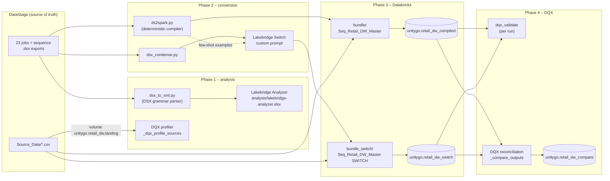

# Retail DW: DataStage → Databricks migration

This folder migrates the 23-job DataStage retail warehouse pipeline (`pipeline/`, exported to
`DataStage Jobs/Pipeline/*.dsx`) to Databricks.

It covers **the tools and terms used** (§0), **what was built** (design), **how we got there** (the
journey, including the dead ends) and **what is still open**.

---

## 0. Background: the pieces and the terms

### The source

- **IBM DataStage**: the ETL tool the pipeline was written for. A *parallel job* is a data flow of
  *stages* (file read, Transformer, Join, Aggregator, …) connected by *links*. A *sequence job* orchestrates
  parallel jobs. This repo's jobs were generated by `pipeline/generate.py` and exported as **DSX**, DataStage's
  text export format. Databricks tools expect the other export format, **XML**.

### The Databricks Labs tools

- **[Lakebridge](https://databrickslabs.github.io/lakebridge/)** ([repo](https://github.com/databrickslabs/lakebridge))
  is Databricks Labs' migration toolkit. We used three of its parts:
  - **[Analyzer](https://databrickslabs.github.io/lakebridge/docs/assessment/analyzer/)**: reads the source
    exports and produces an Excel assessment (jobs, stages, complexity, functions used). Pre-migration analysis.
  - **[BladeBridge](https://databrickslabs.github.io/lakebridge/docs/transpile/pluggable_transpilers/bladebridge/)**:
    Lakebridge's rule-based *transpiler*, a code converter. For DataStage it is meant to turn each XML-exported
    job into a Databricks notebook and each sequence into a Workflow
    ([DataStage guide](https://databrickslabs.github.io/lakebridge/docs/transpile/source_systems/datastage/)).
    **For this repo it produced no notebooks** (§3).
  - **[Switch](https://databrickslabs.github.io/lakebridge/docs/transpile/pluggable_transpilers/switch/)**:
    Lakebridge's *LLM-based* transpiler (experimental). It uploads the source files and runs a Databricks Job that
    sends each file to a Foundation Model with a conversion prompt, then writes the generated notebooks to the
    workspace. The prompt can be replaced with a
    [custom prompt](https://databrickslabs.github.io/lakebridge/docs/transpile/pluggable_transpilers/switch/customizing_switch/),
    which is what made it work here.
- **[DQX](https://databrickslabs.github.io/dqx/)** ([repo](https://github.com/databrickslabs/dqx)) is Databricks
  Labs' data-quality framework for PySpark. Rules ("checks") are declared as metadata and applied by a `DQEngine`.
  Failing rows are reported in `_errors` / `_warnings` columns or quarantined, and
  [summary metrics](https://databrickslabs.github.io/dqx/docs/guide/summary_metrics/) are written to a table.
  We used it three times: to [profile](https://databrickslabs.github.io/dqx/docs/guide/data_profiling/) the
  source files, to [validate](https://databrickslabs.github.io/dqx/docs/guide/quality_checks_apply/) each
  migrated run, and to reconcile the two implementations
  ([`compare_datasets`, `has_valid_schema`](https://databrickslabs.github.io/dqx/docs/reference/quality_checks/)).

### The Databricks platform pieces

- **[Declarative Automation Bundles](https://docs.databricks.com/dev-tools/bundles/)** (Asset Bundles):
  `databricks.yml` + resource YAML that deploys notebooks and jobs with `databricks bundle deploy`.
- **[Lakeflow Jobs](https://docs.databricks.com/aws/en/jobs/)**: the scheduler/orchestrator that replaces the
  DataStage sequence (tasks, dependencies, condition tasks).
- **[Unity Catalog](https://docs.databricks.com/aws/en/data-governance/unity-catalog/)**: tables live in
  `catalog.schema.table`, and the source CSVs sit in a
  [volume](https://docs.databricks.com/aws/en/volumes/) (`/Volumes/unitygo/retail_dw/landing`).

### Terms used in this doc

| Term | Meaning |
|---|---|
| **compiler**, **compiled version** | `ds2spark.py`, written for this migration because BladeBridge produced nothing. It is not a Lakebridge tool. It reads the job definitions in `pipeline/pipeline_def.py` (the model that also generates the DSX) and emits one Databricks notebook per job by fixed rules (§2.1, §2.3). Same input, same output, every time. |
| **Switch version** | The notebooks Switch generated from the DSX exports, using our custom prompt. |
| **two implementations** | The compiled and Switch versions were both deployed and run, each to its own schema, so each could be checked against the other with DQX. The rule-based and LLM routes are both kept: the compiled version is the deterministic reference, and the Switch version shows what Lakebridge's supported tool produces. |
| **validation** | DQX rules on the migrated tables of *one* run (not-null, uniqueness, value ranges, foreign keys …), §5. |
| **reconciliation** | DQX check that the Switch run's tables equal the compiled run's tables, row for row, §6. |

---

## 1. Outcome

| | |
|---|---|
| Source | 23 parallel jobs + 1 master sequence (`Seq_Retail_DW_Master`), 266 stages + 36 sequence activities (see `PIPELINE.md`) |
| Target | Databricks Asset Bundle: one Lakeflow Job (28 tasks), 23 job notebooks + 5 support notebooks, Delta tables in Unity Catalog |
| Workspace / catalog | Azure Databricks workspace (CLI profile `DEFAULT`), catalog `unitygo` |
| Implementations | Two, run side by side (see §0):<br>• **compiled** – our rule-based compiler `ds2spark.py` → `unitygo.retail_dw_compiled`<br>• **Switch** – Lakebridge Switch (LLM) with our custom prompt → `unitygo.retail_dw_switch` |
| Pipeline runs | Both: 27/27 tasks succeed (J05 is correctly *excluded* when `dim_customer` already exists) |
| DQX validation | 19 tables, 66 rules (60 error / 6 warn): **0 error-level violations** in both; identical warnings |
| DQX reconciliation | Switch vs compiled, 39 tables / 109,687 rows: **39/39 match**, 0 schema, row or surrogate-key differences |

Final runs (job run ids):

| Run | Id | Result |
|---|---|---|
| Compiled pipeline | `636922528054694` | SUCCESS, validation clean |
| Switch pipeline | `698138070632909` | SUCCESS, validation clean |
| DQX reconciliation | `272420992913954` | 39/39 match (326 s) |
| DQX reconciliation (with the "optimisation" changes) | `157986346301460` | 39/39 match (566 s – **slower**, see §7) |

---

## 2. Architecture



### 2.1 Mapping DataStage to Databricks

| DataStage | Databricks |
|---|---|
| Parallel job | One Python notebook (`src/notebooks/Jxx_*.py`) |
| Link | One temp view named like the link, built with `spark.sql(...)` |
| Sequential File source, `#pSrcDir#/*.csv` | `spark.read.csv` from the UC volume `unitygo.retail_dw.landing`, **columns renamed by position**, empty strings preserved (§4) |
| Sequential File target or intermediate file (`#pStgDir#`, `#pDwhDir#`, `#pMartDir#`, `#pAuditDir#`) | Delta table `{catalog}.{schema}.<file stem>` (overwrite; append where the stage appends) |
| Transformer derivation | `SELECT CAST(<expr> AS <type>)`, with expressions translated (§2.3) |
| Filter / Join / Aggregator / Sort / Remove Dups / Head / Copy / Funnel | `WHERE` / `JOIN` / `GROUP BY` / `ORDER BY` / `row_number()=1` / `ORDER BY … LIMIT` / extra view / `UNION ALL` |
| Surrogate-key idiom `@PARTITIONNUM + (@NUMPARTITIONS * (@INROWNUM-1)) + 1` | `row_number() OVER (ORDER BY <upstream sort>)` |
| Job parameters | Notebook widgets `catalog`, `schema`, `src_dir`, `pRunDate`, `pEffDate` |

### 2.2 Mapping the master sequence to a Lakeflow Job

`build_bundle.py` generates `resources/retail_dw_job.yml` from `pipeline/pipeline_dag.json`.

| Sequence activity | Job task |
|---|---|
| `act_Prepare_Dirs` + `wff_Source_Orders` | `setup` notebook: creates the schema and waits up to 10 min for the 11 source files |
| `run_Jxx` job activities | `notebook_task` per job |
| `seq_*` sequencers (ALL) | Folded into `depends_on` |
| `act_Check_Dim_Customer` (exec: file exists?) | `check_dim_customer` notebook → task value `dim_state` |
| `run_J05` with custom trigger `= "MISSING"` | `condition_task` `cond_dim_missing` → J05 runs on `true` |
| `seq_Dim_Customer_Ready` (ANY) | J06 `run_if: NONE_FAILED`, depends on J05 and the check |
| `act_Promote_Dim_Customer` (`mv` file) | `promote_dim_customer`: `CREATE OR REPLACE TABLE dim_customer AS SELECT * FROM dim_customer_next` |
| `seq_All_Done` | `dqx_validate` (depends on J14–J23) |
| `exc_Any_Failure`, `act_Notify_*`, `term_Abort` | **Not migrated.** No job notifications are configured yet (§7) |

### 2.3 Expression translation (`ds2spark.py`)

A recursive-descent parser translates DataStage expressions into Spark SQL. It handles
`If … Then … Else` → `CASE`, `And`/`Or`, the `:` concatenation operator, and these functions:
`Trim, Upcase, Downcase, Len, Abs, Left, NullToValue, IsNull, Ereplace, CRC32, StringToDecimal,
StringToDate, StringToTimestamp, DateToString, TimestampToString, DaysSinceFromDate, DateFromDaysSince`.
Date formats are mapped too (`%yyyy%mm%dd` → `yyyyMMdd`, `%nn` → minutes). An unknown function raises an
error instead of being passed through silently.

---

## 3. Journey

### Phase 1: analysis

1. **DSX to XML.** The Lakebridge Analyzer and BladeBridge read only DataStage *XML* exports. The repo only had
   DSX, and no DataStage server was available to re-export. `dsx_to_xml.py` started as a line-based converter.
   It was then rewritten as a tokenizer/parser that follows the DSX grammar from
   [jdelvign/dsxparser](https://github.com/jdelvign/dsxparser) (`DSX.g4`). The rewrite keeps every block
   (`DSJOB`, `DSSTAGETYPES`, `DSTABLEDEFS`, `DSROUTINES`, `DSSHAREDCONTAINER`, `DSUBINARY`); the first version
   dropped everything except `DSJOB`.
2. **Lakebridge Analyzer** (`bladespector`, run on the XML) → `analysis/lakebridge-analyzer.xlsx`:
   24 jobs, 946 nodes. Complexity: **VERY_HIGH** 5 (J06 SCD2, J10 Fact Sales, J17 Customer 360,
   J22 DQ checks, the master sequence), **HIGH** 17, **MEDIUM** 2 (J05, J12). Marked *supported*:
   Sequential File, Filter, Join, Aggregator, Copy, Sort, Remove Duplicates, Funnel, Job Activity, Sequencer.
   Marked *not supported*: `CTransformerStage` and `CCustomStage` (even though the Lakebridge docs list
   Transformer as supported), plus the exec-command, notify, wait-for-file, terminator and exception-handler
   activities.
3. **DQX source profiling** (`_dqx_profile_sources`): `DQProfiler` + `DQGenerator` over the 11 source CSVs,
   from 12 rows (suppliers) to 33,732 rows (orders). Candidate rules: 2–23 per file. Results are in
   `unitygo.retail_dw.dq_source_profile`. The candidates are not applied as-is. The validation rules (§5) were
   written by hand from the DataStage job logic, and the candidates are kept for review.

### Phase 2: conversion

| Attempt | Result |
|---|---|
| **BladeBridge** (Lakebridge's DataStage transpiler, pip `databricks-bb-plugin`, binary run directly) | Parses the XML (finds the job, nodes and links) but generates **no notebooks**. Its only output is `databricks_conversion_supplements.py`. Same result for: all 24 pipeline jobs, the repo's original real export (`RETAIL_DATA_MART_Job.dsx`), six genuine IBM-authored DataStage 8.5 sample jobs ([IBM XML-stage examples](https://www.ibm.com/support/pages/infosphere-datastage-example-files-xml-transformation)), PYSPARK and SPARKSQL targets, the configs named in the converter README, and the grammar-faithful XML. The official `lakebridge transpile` CLI fails with `Client has not yet registered its transpile capability`. **Unresolved**: without one genuine Designer XML export we cannot tell whether the XML shape or the tool is at fault. |
| **Compiler** (`ds2spark.py`, see §0) | Reads the in-memory job model (`pipeline/pipeline_def.py`, the same model that generates the DSX). Deterministic. Became the reference implementation. |
| **Switch #1**, built-in `unknown_etl` prompt | 24/24 "converted" with no errors, but produced [Spark Declarative Pipeline](https://docs.databricks.com/aws/en/dlt/) code: only 1 of 24 files had `@dp` decorators, references to tables that are never created, Windows paths left in, and an invented master-sequence notebook. **Unusable.** |
| **Switch #2**, custom notebook prompt + few-shots | Usable. Matched the compiled version structurally (same 208 views, reads and writes in all 23 jobs). 170/208 views had identical normalised SQL. **4 real defects:** a `LIMIT` lost its upstream `ORDER BY` (wrong Top-N in J14, J16, J18, J19). |
| **Switch #3**, improved prompt + adaptive thinking | 0 lost `ORDER BY`, 11/11 CSV reads mapped by position. The remaining 56 SQL differences were all classified as cosmetic. (The first attempt failed outright: `thinking.type: enabled` is rejected by `databricks-claude-sonnet-5-5`, which needs `{"type": "adaptive"}` + `output_config.effort`.) |
| **Switch #4**, adds the empty-field rule (§4) | Final version in `bundle_switch/`. 23/23 converted, 526k tokens. |

Switch input: raw DSX is 100–400 KB per job and exceeds Switch's token threshold.
`dsx_condense.py` renders each job from the DSX itself as a compact text description (parameters, stages,
properties, links, columns, derivations), at most 42k characters (about 12.4k tokens) per job.

### Phase 3: run on Databricks, where the real bugs appeared

Running both versions against real data exposed DataStage semantics that neither the compiler nor the LLM
had reproduced. DQX caught them. See §4.

### Phase 4: validation and reconciliation

Covered in §5 and §6.

---

## 4. DataStage semantics that had to be reproduced

These four issues were each found by running the pipeline or by DQX, not by reading the code. They apply to
both implementations. The Switch prompt now spells out each one.

| # | DataStage behaviour | Naive Spark behaviour | Symptom | Fix |
|---|---|---|---|---|
| 1 | Sequential File maps columns **by position**; the header text is ignored | `spark.read.csv(header=true)` + select by name | J03 failed: `UNRESOLVED_COLUMN SupplierCountry` (the file header says `Country`) | Assert the column count, then `.toDF(<declared names>)` |
| 2 | An empty field in a **non-nullable string** column is `""` | Empty CSV field → `NULL` | `If Len(Trim(CustomerID)) = 0` never fired, so 9,269 order lines had `customer_id NULL` and **`is_guest = 0` on every row**. DQX `is_not_null` caught it | `coalesce(col, '')` on non-nullable source string columns |
| 3 | A Sort's order flows through Copy/Filter/Transformer into a Head (first *n* rows in sort order) | Temp views do not keep order; a bare `LIMIT` returns arbitrary rows | Switch #2 produced wrong Top-N marts | `ORDER BY <upstream sort keys> LIMIT n` |
| 4 | Surrogate keys numbered by input row order (`@INROWNUM`) | No inherent row order | `store_sk`, `employee_sk`, `promo_sk` are only as deterministic as the file read order | `row_number() OVER (ORDER BY …)`. Reconciliation treats these keys as warnings (§6) |

---

## 5. DQX validation (`_dqx_validate`, last task of each run)

- **Rules:** 66 metadata rules on 19 tables (60 error, 6 warn): not-null, uniqueness of grain, allowed values,
  SCD2 invariants (`eff_start_key <= eff_end_key`, an open-ended current row), measure signs, foreign keys from
  facts to dimensions, RFM score ranges, and `audit_reconciliation.status = 'PASS'` (DataStage J23).
- **Run:** `DQEngine.validate_checks` first, then `apply_checks_by_metadata`. Results go to
  `<schema>.dq_validation_results` and failing rows to `<schema>.dq_quarantine_<table>`. The task fails the job
  on any error-level violation.
- **Final result (both schemas):** 0 errors. Warnings, which are expected data conditions:

  | Table | Rule | Rows |
  |---|---|---|
  | fact_sales | guest_customer (customer_sk = -1) | 9,106 |
  | fact_sales | gross_profit_not_negative | 934 |
  | fact_sales | zero_price_line | 87 |
  | fact_invoice | zero_value_invoice | 44 |
  | fact_sales | orphan_product | 12 |

- **Rule corrections made along the way:** `sales_amount > 0` and `invoice_sales > 0` were too strict.
  DataStage J01 deliberately keeps zero-price lines, so these became `>= 0` (error) plus a `> 0` warning.
  Also, DQX ≥ 0.16 reads a bare string in `is_in_list(allowed=…)` as a *column*, so literals are now quoted (`'UK'`).

## 6. DQX reconciliation: Switch vs compiled (`_compare_outputs`)

The Switch output is the dataset under check; the compiled output is the reference. Everything is DQX-native:

1. One rule set per table, stored in DQX checks storage (`TableChecksStorageConfig`, table
   `unitygo.retail_dw_compare.dq_compare_checks`, `run_config_name` = table name):

   | Rule | DQX function | Severity |
   |---|---|---|
   | `schema_matches` | `has_valid_schema(ref_table, strict=True)`: same columns, order and types | error |
   | `rows_match` | `compare_datasets` on the table's natural key, `check_missing_records`, excluding input-order surrogate keys | error |
   | `surrogate_keys_match` | `compare_datasets` including `store_sk` / `employee_sk` / `promo_sk` | warn |

2. `DQEngine.apply_checks_and_save_in_tables` with one `RunConfig` per table. A `DQMetricsObserver` writes summary
   metrics to `dq_compare_metrics`. Only tables that differ are re-run with a quarantine config
   (`<table>_dq_quarantine`).
3. The report is read from DQX's per-check metrics (`check_metrics.error_count` / `warning_count`).

**Result:** 39/39 tables match. `checked_count` equals the input row count (for example, 32,575 for
`fact_sales`), so the checks really ran. A separate `EXCEPT ALL` on `fact_sales`, `dim_store` and
`product_top50` agrees: 0 differences.

Caveat: the Switch prompt uses compiled notebooks as few-shot examples, so the two implementations are
not fully independent. Agreement shows that Switch reproduced the compiler's semantics. It does not prove
the semantics independently. Validation against DataStage itself would need DataStage output for
the same inputs (see §7).

### Static comparison of notebooks (`compare_notebooks.py`)

Before running, each Switch generation was compared view by view against the compiled notebooks:

| Metric | Switch #2 | Switch #3 | Switch #4 |
|---|---|---|---|
| Views with identical normalised SQL | 170/208 | 152/208 | 152/208 |
| `LIMIT` that lost its `ORDER BY` | 4 | 0 | 0 |
| CSV reads mapped by position | 0/11 | 11/11 | 11/11 |
| Non-nullable source strings wrapped in `coalesce` | – | – | 50 (compiled: 50) |

---

## 7. Open items and known limitations

- **BladeBridge produces no notebooks** (§3). It needs one genuine DataStage Designer XML export to tell
  whether our XML shape or the tool is at fault. Alternatively, raise a Lakebridge issue with the logs we collected.
- **No comparison against DataStage output.** `Output_Data/` holds outputs of the *original* 4 jobs, not the
  23-job pipeline. Running the DataStage jobs on the same inputs and reconciling (Lakebridge Reconcile or
  DQX `compare_datasets`) is the remaining proof of equivalence.
- **Failure notifications not migrated** (`exc_Any_Failure`, `act_Notify_*`). Add `email_notifications` /
  webhooks to the job.
- **SCD2 re-runs.** As in the DataStage sequence, a re-run skips J05 and applies the 2011 snapshot again to
  the promoted `dim_customer`. That matches the source behaviour, but production would need a
  snapshot-per-run input.
- **Input-order surrogate keys** (`store_sk`, `employee_sk`, `promo_sk`) depend on file read order. Consider
  ordering them by the natural key.
- **Reconciliation runtime.** The first version took 326 s for 39 small tables. Several changes meant to speed it
  up (parallel rule saves, `raise_on_duplicate_keys`, parallelism 4→12, metrics-only first pass, conditional
  quarantine) made it **566 s**. This hasn't been profiled yet. The suspects are that changing the rule
  fingerprints forced all 39 rule sets to be rewritten, and that 12 concurrent `replaceWhere` writers to one checks table
  conflict and retry. Profile before changing it further.
- **Environment pinning.** Jobs use serverless environment version 5. Version 2 rejects `DataFrame.cache()`.
- **Cost.** Each Switch run uses about 0.5M tokens on `databricks-claude-sonnet-5-5`.

---

## 8. How to run

Prerequisites: Databricks CLI ≥ 1.0, profile `DEFAULT` on the workspace, and `CREATE SCHEMA` on catalog
`unitygo`. The source CSVs go in `/Volumes/unitygo/retail_dw/landing`.

```bash
# regenerate code (local, no workspace needed)
python3 migration/dsx_to_xml.py "DataStage Jobs/Pipeline" migration/xml   # XML for Lakebridge Analyzer
python3 migration/ds2spark.py                                              # compiled notebooks
python3 migration/build_bundle.py                                          # job YAML + support notebooks
python3 migration/dsx_condense.py "DataStage Jobs/Pipeline" migration/switch_input
python3 migration/switch_prompt/build_prompt.py                            # Switch prompt (few-shots from compiled)

# deploy and run (compiled)
cd migration/bundle && databricks bundle deploy -t dev && databricks bundle run retail_dw_master -t dev

# Switch: install once, then convert. Set conversion_prompt_yaml in migration/switch_config.yml to your
# workspace path and upload it to /Workspace/Users/<you>/.lakebridge/switch/resources/switch_config.yml
databricks labs lakebridge install-transpile --include-llm-transpiler true
databricks labs lakebridge llm-transpile --input-source migration/switch_input_jobs \
  --output-ws-folder /Workspace/Users/<you>/retail_dw_switch_nb_vN --source-dialect unknown_etl \
  --catalog-name unitygo --schema-name retail_dw --volume switch_volume \
  --foundation-model databricks-claude-sonnet-5-5 --accept-terms true
# export the notebooks into migration/bundle_switch/src/notebooks, then deploy/run bundle_switch

# reconcile the two schemas
cd migration/bundle && databricks bundle run retail_dw_compare -t dev
```

Two operational notes. With two CLI profiles on the same host, Lakebridge's inner Python needs
`DATABRICKS_CONFIG_PROFILE=DEFAULT` exported. `switch_input_jobs/` is `switch_input/` without the master sequence.

## 9. Layout

| Path | What |
|---|---|
| `dsx_to_xml.py` | DSX → DataStage XML (grammar from dsxparser), for Lakebridge |
| `dsx_condense.py` | DSX → compact job description, the Switch input |
| `ds2spark.py` | Deterministic compiler: job model → Databricks notebooks |
| `build_bundle.py` | Master sequence → Lakeflow Job YAML + support notebooks |
| `run_bladebridge.py` | Runs BladeBridge locally (kept as the reproduction of the no-output issue) |
| `compare_notebooks.py` | Static view-by-view comparison of two notebook sets |
| `switch_prompt/` | `build_prompt.py` → `datastage_to_notebook.yml` (Switch custom prompt) |
| `switch_config.yml` | Switch configuration (prompt path, adaptive thinking) |
| `analysis/lakebridge-analyzer.xlsx` | Lakebridge Analyzer report |
| `bundle/` | Compiled implementation + DQX profile, validate and reconcile jobs |
| `bundle_switch/` | Switch implementation (same support notebooks) |
| `switch_input/` | Condensed jobs sent to Switch |
| `switch_output*/` | Switch outputs per attempt (#1 SDP, #2 `_nb`, #3 `_nb_v2`, #4 `_nb_v3`), kept as evidence |
| `compare_*.json` | Static comparison results per Switch generation |
