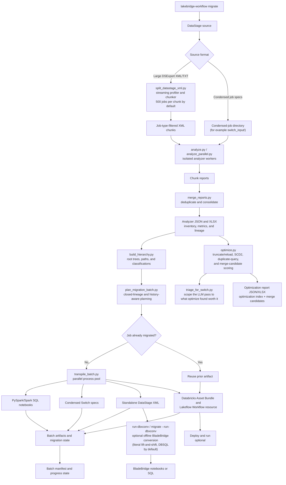

# Lakebridge workflow package

`lakebridge_workflow/` contains the end-to-end Lakebridge Analyzer, lineage, planning, and
migration workflow as an installable Python package. It is designed to work with:

- condensed DataStage job specifications, such as the files in `../switch_input/*.txt`
- a genuine large `DSExport` XML/TXT export when one is available
- a migration checkout containing the repository-specific compiler, bundles, and source exports

The package does not assume a fixed job count, hierarchy shape, complexity distribution, or
batch size.

## End-to-end workflow

The workflow supports two source entry points: condensed job specifications for an existing
repository checkout and a genuine large DataStage `DSExport` for a new migration assessment.
Both paths converge on the same analyzer, hierarchy, planning, and transpilation stages.



The exact artifacts and counts are derived from the selected source and lineage closure rather
than fixed in the workflow.

## Package layout

```text
lakebridge_workflow/
├── README.md
├── pyproject.toml
├── docs/lakebridge_analyzer_windows_guide-v6.md
├── scripts/run_dbxconv.ps1
├── src/lakebridge_workflow/
│   ├── __main__.py              # lakebridge-workflow CLI dispatcher
│   ├── workflow.py              # one-command end-to-end workflow
│   ├── common.py                # condensed-job parser and XLSX utilities
│   ├── paths.py                 # checkout discovery for installed wheel
│   ├── split_datastage_xml.py
│   ├── analyze.py
│   ├── analyze_parallel.py
│   ├── merge_reports.py
│   ├── build_hierarchy.py
│   ├── optimize.py             # truncate/reload, SCD2, duplicate-query, merge-candidate report
│   ├── triage_for_switch.py    # scope the LLM/Switch pass to what optimize found worth it
│   ├── migrate.py
│   ├── plan_migration_batch.py
│   ├── transpile_batch.py
│   ├── run_dbxconv.py
│   └── fix_dbxconv_output.py    # patches dbxconv's output so it actually runs (12 defects)
└── dist/                        # built wheel artifacts
```

## Build the wheel

The package uses the built-in `uv_build` backend. It does not declare or download a
`setuptools` build dependency.

From the package folder:

```powershell
uv build --wheel --out-dir dist
```

From `migration/`:

```powershell
uv build --wheel --out-dir lakebridge_workflow/dist lakebridge_workflow
```

The checked-in wheel is generated by `uv 0.9.5`; its `WHEEL` metadata reports:

```text
Generator: uv 0.9.5
```

## Install and run

Select the newest wheel dynamically rather than referring to a fixed package version.

PowerShell:

```powershell
cd migration
$wheel = Get-ChildItem .\lakebridge_workflow\dist\*.whl |
  Sort-Object LastWriteTime -Descending |
  Select-Object -First 1

uv run --with $wheel.FullName lakebridge-workflow --version
```

Bash or Zsh:

```bash
cd migration
wheel="$(ls -t lakebridge_workflow/dist/*.whl | head -n 1)"

uv run --with "$wheel" lakebridge-workflow --version
```

Or install the selected wheel into an existing Python environment:

```powershell
python -m pip install $wheel.FullName
lakebridge-workflow --version
```

The package locates a migration checkout from the current directory or its parents. To point
to a checkout explicitly, set:

```powershell
$env:LAKEBRIDGE_MIGRATION_ROOT = "C:\path\to\repository\migration"
```

## Prerequisites

The package separates the Python Analyzer command from the native BladeBridge converter.

| Component | How it is provided | Required for | Interface |
|---|---|---|---|
| Lakebridge workflow package | Built and installed from `dist/*.whl` | All commands | `lakebridge-workflow` |
| `databricks-bb-analyzer` | Installed into the same `uv`/Python environment | Official analysis of XML `DSExport` chunks | Console command `databricks-bb-analyzer` on `PATH`, or `--external-command` |
| `databricks-bb-plugin` | Manually downloaded and unpacked | Optional offline `dbxconv` conversion | Extracted plugin folder passed to `run-dbxconv --plugin-dir`, or `migrate --run-dbxconv --dbxconv-plugin-dir` |

### Analyzer prerequisite

The Analyzer is a normal Python package. It does **not** use a folder flag. Install it into
the same ephemeral `uv` environment as the workflow wheel:

```powershell
uv run `
  --with ./lakebridge_workflow/dist/<wheel-file> `
  --with "databricks-bb-analyzer~=0.3.0,!=0.3.1" `
  lakebridge-workflow migrate `
  --source <DSExport-or-condensed-source> `
  --num-jobs <target-new-items>
```

The workflow discovers `databricks-bb-analyzer` on `PATH`. For a nonstandard launcher, use:

```text
--external-command "<analyzer-executable> --source-directory {source} --report-file {report} --source-tech Datastage --generate-json"
```

### BladeBridge plugin prerequisite

The BladeBridge plugin is **not installed automatically** by this package. It is needed only
when you run offline `dbxconv` conversion, either separately through `run-dbxconv` or through
`migrate --run-dbxconv`.

The plugin wheel contains a native `dbxconv` binary and its converter configuration tree.
Unpack it once into a local folder, for example:

```powershell
python -m zipfile -e <databricks_bb_plugin-wheel-file> bb_plugin
```

Then pass that folder to the converter command:

```powershell
uv run --python 3.12 `
  --with ./lakebridge_workflow/dist/<wheel-file> `
  lakebridge-workflow run-dbxconv `
  --plugin-dir bb_plugin `
  <xml-source-or-dir> `
  <output-dir> `
  <PYSPARK|SPARKSQL|DBSQL>
```

BladeBridge's native runtime supports Python 3.10–3.14; Python 3.12 is the recommended
offline runner.

By default, `migrate` stops after deterministic transpilation and does **not** invoke
`dbxconv`. Supply `--run-dbxconv` to extend the same command through offline BladeBridge
conversion.

## One-command migration workflow

Use `migrate` to run the complete workflow from either a large `DSExport` file or a
condensed-job directory. For a `DSExport`, the command automatically:

1. Splits sequence and ETL jobs into XML chunks
2. Analyzes the chunks in parallel
3. Merges the reports
4. Builds the job hierarchy
5. Scores optimization opportunities (truncate/reload writes, hand-rolled SCD2, duplicate
   queries, missing filters) and merge candidates
6. Plans a closed-lineage batch
7. Transpiles the batch in parallel
8. Optionally runs offline BladeBridge conversion when `--run-dbxconv` is supplied

`dbxconv` (step 8) stays a literal lift-and-shift: it converts each job stage by stage
with no re-architecture. The optimization report (step 5) is the only place this workflow
suggests re-architecting anything, and it never changes what `dbxconv` or the deterministic
transpiler produce.

### Required flags

| Flag | Value |
|---|---|
| `--source` | Large `DSExport` XML/TXT file or condensed-job directory |
| `--num-jobs` | Target number of new migration items |

The minimal command is:

```powershell
lakebridge-workflow migrate `
  --source <DSExport-or-condensed-source> `
  --num-jobs <target-new-items>
```

### Optional flags and defaults

| Flag | Default | Purpose |
|---|---|---|
| `--jobs-per-file` | `500` | Jobs per XML chunk when splitting a `DSExport` |
| `--workers` | Omitted; one worker per XML chunk | Analyzer workers. A lower explicit count distributes chunks across those workers |
| `--transpile-workers` | Omitted; one worker per selected job | Transpiler workers. A lower explicit count distributes jobs across those workers |
| `--analysis-dir` | `<migration-root>/lakebridge_workflow_analysis` | Directory for chunks, worker reports, merged report, and hierarchy |
| `--state-file` | `<migration-root>/migration_state.json` | Migration history file |
| `--output-root` | `<migration-root>/migrated_batches` | Root directory for generated batches |
| `--filter` | No filter | Optional root-name or folder substring filter |
| `--external-command` | Discover `databricks-bb-analyzer` on `PATH` | Official analyzer command with `{source}`, `{report}`, and `{json}` placeholders |
| `--reset-history` | `false` | Start from an empty migration state |
| `--overwrite` | `false` | Replace an existing batch output directory |
| `--plan-only` | `false` | Stop after the dry-run batch plan |
| `--no-xml` | `false` | Skip standalone XML copies; notebooks are still generated |
| `--run-dbxconv` | `false` | Run offline BladeBridge conversion after deterministic transpilation |
| `--dbxconv-plugin-dir` | `bb_plugin` | Manually unpacked `databricks_bb_plugin` wheel root; used only with `--run-dbxconv` |
| `--dbxconv-target` | `DBSQL` | BladeBridge target: `PYSPARK`, `SPARKSQL`, or `DBSQL` |
| `--dbxconv-output-dir` | `<batch-dir>/bladebridge_<target>` | BladeBridge output directory; used only with `--run-dbxconv` |

Common path, chunking, worker, and analyzer overrides are:

```powershell
lakebridge-workflow migrate `
  --source <DSExport-or-condensed-source> `
  --num-jobs <target-new-items> `
  --jobs-per-file <jobs-per-chunk> `
  --workers <analyzer-worker-count> `
  --transpile-workers <transpiler-worker-count> `
  --analysis-dir <analysis-dir> `
  --state-file <state-file> `
  --output-root <batch-output-root> `
  --filter <root-or-folder-filter> `
  --external-command "<analyzer-command-with-placeholders>"
```

Behavior flags are used individually, according to the run mode:

```powershell
# Preview assessment, hierarchy, and the closed-lineage plan without transpiling.
--plan-only

# Start a fresh migration history and replace an existing batch directory.
--reset-history --overwrite

# Generate notebooks and workflow but skip standalone XML copies.
--no-xml

# Also run offline BladeBridge conversion after deterministic transpilation.
--run-dbxconv `
--dbxconv-plugin-dir <bb-plugin-dir> `
--dbxconv-target <PYSPARK|SPARKSQL|DBSQL> `
--dbxconv-output-dir <bladebridge-output-dir>
```

If an official analyzer is not on `PATH`, pass its launcher through
`--external-command`. The command accepts the same `{source}`, `{report}`, and `{json}`
placeholders used by `analyze-parallel`.

Generated chunk and report subdirectories under `<analysis-dir>` are recreated on each run so
stale files from a previous export cannot enter the new analysis. Use a different
`<analysis-dir>` if you need to preserve a previous analysis run.

## One-command condensed workflow

The `workflow` command is a shortcut for an existing condensed-job checkout. It runs four
generic phases:

1. Analyzer assessment
2. Sequence-to-ETL hierarchy construction
3. Closed-lineage batch planning
4. Deterministic batch transpilation

Use `<target-new-items>` as the desired number of new migration items:

```powershell
cd migration
$wheel = Get-ChildItem .\lakebridge_workflow\dist\*.whl |
  Sort-Object LastWriteTime -Descending |
  Select-Object -First 1

uv run `
  --with $wheel.FullName `
  lakebridge-workflow workflow `
  --num-jobs <target-new-items> `
  --transpile-workers <transpiler-worker-count> `
  --reset-history `
  --overwrite
```

Preview assessment, hierarchy, and the batch plan without changing migration state:

```powershell
lakebridge-workflow workflow --plan-only
```

A selected root sequence is always migrated with its full descendant closure. If the first
root closure is larger than `<target-new-items>`, the planner keeps the complete tree instead
of cutting it in half.

Parallel transpilation is controlled with `<transpiler-worker-count>`. When omitted, the
workflow uses one worker per selected job. If a lower explicit count is supplied, jobs are
distributed across those workers. Each worker process independently compiles one job's
notebook, copies its Switch specification, and creates its standalone XML. Workflow
generation and migration-state updates remain single-writer operations.

The generated batch directory contains artifacts derived from the selected lineage:

- compiled PySpark/Spark SQL notebooks for selected parallel jobs
- a Lakeflow Workflow resource for the selected root sequence
- condensed Switch input specifications for newly migrated jobs
- standalone DataStage XML files when source DSX files are available
- support notebooks required by the source sequence
- a Databricks Asset Bundle
- `manifest.json`, `batch_summary.csv`, and updates to `migration_state.json`

## Individual commands

After installing the wheel, the tools are available through one CLI:

```powershell
lakebridge-workflow analyze --list-tech
lakebridge-workflow analyze --source-directory <condensed-or-xml-source> --report-file <report-prefix>.xlsx --source-tech Datastage --generate-json
lakebridge-workflow build-hierarchy --input-json <report-prefix>.json --out-prefix <hierarchy-prefix>
lakebridge-workflow optimize --input-json <report-prefix>.json --out-prefix <optimization-report-prefix>
lakebridge-workflow triage-for-switch --optimization-json <optimization-report>.json --condensed-dir <condensed-dir> --out-dir <triaged-dir> --dry-run
lakebridge-workflow fix-dbxconv --dbxconv-dir <run-dbxconv-output> --condensed-dir <condensed-dir> --catalog <catalog> --schema <schema> --out-dir <fixed-dir>
lakebridge-workflow plan --num-jobs <target-new-items> --dry-run
lakebridge-workflow transpile `
  --num-jobs <target-new-items> `
  --workers <transpiler-worker-count> `
  --reset-history `
  --overwrite
lakebridge-workflow plan --status
```

Equivalent module form is also supported:

```powershell
python -m lakebridge_workflow analyze --list-tech
python -m lakebridge_workflow workflow --plan-only
```

## Generated assessment

The consolidated report computes its values from the selected source at runtime. It includes:

- total unique items
- total nodes
- counts by job type
- counts by complexity level
- sequence-to-job links
- root-to-leaf lineage paths
- transformations, parameters, expressions, attributes, and embedded SQL when available

The exact numbers depend on the source export or condensed-job directory passed to the CLI.

## Complexity scoring (Lakebridge Analyzer)

`inventory[].complexityLevel` in the consolidated report -- the field `build-hierarchy`
and `optimize` both read, and the column the `Job Details` tab of
`analysis/lakebridge-analyzer.xlsx` calls `Categorization` -- is the official Lakebridge
Analyzer's complexity score, not something this package computes. Every object gets one
of four levels, used to prioritize migration effort and flag what needs manual review
after transpilation:

| Level | What it means | Typical action |
|---|---|---|
| **LOW** | Few components, no advanced constructs | Transpile directly; little or no manual review expected |
| **MEDIUM** | Moderate use of joins/lookups/expressions | Transpile; review transpiler warnings before deploying |
| **HIGH** | Heavy use of joins/lookups/expressions, or complex/unstructured stages | Plan for manual review after transpilation; test thoroughly |
| **VERY_HIGH** | Very heavy use of the above, or three HIGH breaks at once | Allocate dedicated review time; consider Switch for intent-aware conversion |

For DataStage specifically, the official rules
([`complexity_scoring.mdx`](https://github.com/databrickslabs/lakebridge/blob/main/docs/lakebridge/docs/assessment/analyzer/complexity_scoring.mdx))
start every job at LOW, then raise it the first time a threshold is crossed:

| Raise to | Any one of |
|---|---|
| MEDIUM | 2-4 expressions with 5+ function calls · >1 source · >=1 join · 4-6 lookups · >1 target · >=10 total function calls |
| HIGH | three MEDIUM breaks at once · 5-7 expressions with 5+ function calls · >=20 job components · >=20 total function calls · a complex/unstructured stage (e.g. `ChangeCapture`) · 7-14 lookups |
| VERY_HIGH | three HIGH breaks at once · >7 expressions with 5+ function calls · >15 lookups · >=50 job components |

This repository's checked-in `analysis/lakebridge-analyzer.xlsx` was produced by the real
Analyzer (`bladespector`, §3 of `migration/README.md`) against these exact rules: VERY_HIGH
5 (J06 SCD2, J10 Fact Sales, J17 Customer 360, J22 DQ checks, the master sequence), HIGH 17,
MEDIUM 2. When the Analyzer binary is not available, `analyze`'s offline fallback
(`common.complexity_from_nodes`) approximates it from a much simpler formula --
`total_nodes + expressions * 2`, bucketed at 10/25/60 -- for condensed jobs the checked-in
workbook doesn't already cover. It is a stand-in, not a reimplementation of the rules above;
a job present in `analysis/lakebridge-analyzer.xlsx` always keeps the authoritative value
(`analyze.read_authoritative_metrics`).

## Optimization scoring (this package)

Complexity says how hard a job is to migrate. It says nothing about whether the job's
*design* is worth revisiting once it lands -- a LOW-complexity job can still be a blind
truncate-and-reload, and a VERY_HIGH job can be VERY_HIGH precisely because it hand-rolls
logic Databricks now does natively (DataStage's own rules single out exactly this:
"Complex or Unstructured nodes... (ChangeCapture, etc.)" is a HIGH break). `optimize` is
a second, independent scoring pass over the same consolidated JSON that answers that
second question, for one source technology (DataStage) instead of the Analyzer's eight.
It does not touch `dbxconv` or the deterministic transpiler; both stay a literal
lift-and-shift. It looks for nine known DataStage-to-Databricks and general SQL-tuning wins,
grouped by what they're really about:

**Re-architecting a DataStage idiom:**

| Finding | What it looks for | The Databricks win |
|---|---|---|
| Truncate-and-reload writes | A target stage whose write mode is a full overwrite/truncate/replace | `MERGE` or Auto CDC instead of a full rewrite every run |
| Hand-rolled SCD2 / change-detection | A Join between a snapshot and the current state, branching by hand into expire/carry/new-version logic | `create_auto_cdc_from_snapshot_flow` -- this repository's own SCD2 job (`migration/README.md` §7) is the worked example |

**General SQL/ETL tuning, independent of DataStage:**

| Finding | What it looks for | The win |
|---|---|---|
| Duplicate queries | The same embedded SQL statement, filter predicate, or derivation expression repeated across *different* jobs | Factor into one shared view, macro, or parameterized job (also surfaced as a merge candidate) |
| Filters pushed too late | A join/lookup/aggregation with no filter stage anywhere in the job, or embedded SQL with no `WHERE` | Push the predicate before the expensive stage |
| Non-sargable predicates | A filter/`WHERE` wraps the compared column in a function (`Upcase(x) = 'Y'`, `UPPER(x)`, a `CAST`, a date truncation, ...) | Compare the raw column so partition pruning / data skipping can use the filter |
| OR-heavy predicates | Several ORs in one predicate, usually across different columns | Split into separate reads unioned together, or an IN-list, so each branch prunes independently |
| Cartesian-risk joins | A join stage with no declared key, or embedded SQL with a `JOIN` and no `ON`/`USING` | A silent row-count explosion caught before it becomes a `MERGE`/join on Databricks |
| Embedded-SQL set-operation issues | `SELECT *`, a wide `SELECT DISTINCT`, `UNION` instead of `UNION ALL`, a subquery inside `WHERE` | Column pruning, a narrower `row_number()` dedup key, one fewer shuffle, or a join instead of a per-row subquery |
| Repeated derivations within one job | The same non-trivial expression computed more than once in the same job (excluding DataStage's `@INROWNUM`/`@PARTITIONNUM`/`@NUMPARTITIONS` row-context macros -- two columns using the same row-numbering formula are two independent counters, not the same value twice) | Compute it once, reuse it |

Each job's findings are weighted into a score, exactly the way the Analyzer starts a job
at LOW and raises it on each break -- except here the breaks add up instead of just
raising a level, since a job can need more than one of these fixes at once:

```text
score = 4  if hand-rolled SCD2/change-detection is present
      + 5  if any join has no declared key (cartesian risk)
      + 2 * min(truncate-and-reload write count, 3)
      + 2 * min(join/aggregate-without-a-filter count, 3)
      + 2 * number of duplicate-logic groups this job belongs to
      + 2 * min(repeated-derivation-within-job group count, 2)
      + 1 * min(non-sargable predicate count, 3)
      + 1 * min(OR-heavy predicate count, 2)
      + 1 * min(embedded-SQL set-operation issue count, 3)
```

| Band | Score | Typical cause |
|---|---|---|
| **NONE** | 0 | No findings; excluded from the report |
| **LOW** | 1-3 | A single truncate-and-reload write and nothing else |
| **MEDIUM** | 4-7 | Several truncate-and-reload writes, or one plus a smaller finding |
| **HIGH** | >=8 | A hand-rolled SCD2 pattern, a cartesian-risk join, or several findings stacked on one job |

The caps (`min(..., n)`) keep one very large job from drowning out everything else in the
same way the Analyzer's own thresholds are bucketed rather than unbounded; the weights are
deliberately lower for the general SQL-tuning findings than for the two DataStage-specific
ones, so a single OR-heavy predicate on an otherwise clean job can't by itself push it into
HIGH. Duplicate-logic groups that span two or more jobs are also listed separately as
**merge candidates** -- the specific jobs sharing the duplicated logic, and a suggested
consolidation.

```powershell
lakebridge-workflow optimize --input-json <report-prefix>.json --out-prefix optimization_report
```

Output: `optimization_report.json` / `.xlsx` with a `Summary`, `Optimization Index`,
`Truncate-Reload Writes`, `SCD2 Candidates`, `Duplicate Queries`, `Queries Without
Filters`, `Non-Sargable Predicates`, `OR-Heavy Predicates`, `Cartesian-Risk Joins`,
`Embedded SQL Set Issues`, `Repeated Expr. Within Job`, and `Merge Candidates` tab.
`migrate` and `workflow` run it automatically (no extra flag) right after the hierarchy
build. This repository's own result, from its 23 jobs, is checked in at
[`../analysis/optimization_report.xlsx`](../analysis/optimization_report.xlsx): 7 HIGH /
12 MEDIUM / 4 LOW, with J06 correctly isolated as the one SCD2 candidate and J01 as the one
OR-heavy predicate (`migration/README.md` §8b has the full breakdown). The five
general-SQL-tuning findings all come back empty on this specific repository -- its 23 jobs
have no embedded SQL and its filters/joins are hand-built cleanly -- which is itself a
useful result: those checks ran and found nothing to flag, rather than not having run.

Like the Analyzer's complexity score, this is a heuristic screening tool: every finding
needs a human to confirm it is worth acting on. Unlike the Analyzer, the rules here are
regexes over stage/property names and text, not a parsed grammar -- see the module
docstring in `optimize.py` for why they deliberately avoid `\b` word boundaries on
DataStage's `Px`-prefixed/underscore-joined identifiers, and tune them for other naming
conventions before trusting them on a different source. One concrete case found and ruled
out while building the repeated-derivation check: this repository's J08 computes the same
`@PARTITIONNUM + (@NUMPARTITIONS * (@INROWNUM - 1)) + 1` formula for both `store_sk` and
`employee_sk` -- textually identical, but two unrelated surrogate-key counters on two
different links, not the same value computed twice. The check excludes DataStage's
row-context macros for exactly this reason.

## Scoping the Switch/LLM pass (`triage-for-switch`)

`optimize` and `dbxconv`/`transpile` are both free: a regex pass over a JSON report, and a
local binary or deterministic compiler, with no API call either way. Switch is not --
this repository's own 23-job run cost about 526k tokens on `databricks-claude-sonnet-5-5`
(§8, "Cost"), roughly 22.9k tokens per job. At real migration scale -- hundreds of jobs,
thousands, or far more for a source with a very large number of embedded queries --
running every item through Switch "to see if SDP (or even just a better notebook) helps"
is not a cost most budgets survive, and it isn't necessary. That is exactly what
`optimize`'s index is for: it says which jobs are worth that spend, in advance, for free.

The recommended order for a real migration, cheapest and least risky first:

1. **`dbxconv`** (or the deterministic `transpile`) over the full estate. Free, offline,
   no API call -- the literal lift-and-shift (`migration/README.md` §8a).
2. **Validate that output** against the source before trusting it: run it, and reconcile
   it against source behavior where you can. This package does not automate that
   validation step; `migration/README.md` §5-6 is how this repository did it (DQX). Don't
   skip this to get to the exciting part faster -- it's the step that tells you the
   lift-and-shift baseline is actually correct before you spend anything re-architecting
   parts of it.
3. **`optimize`** over the same full estate. Free, regex-only, no API call: the
   HIGH/MEDIUM/LOW optimization index and merge-candidate list.
4. **`triage-for-switch`** to turn that index into a small, deliberately scoped Switch
   input directory -- never "every job, to be safe."
5. **Switch**, only on that subset. The only step here with a per-token cost.

```powershell
lakebridge-workflow triage-for-switch `
  --optimization-json optimization_report.json `
  --condensed-dir switch_input `
  --out-dir switch_input_triaged `
  --bands HIGH
```

Selection combines, by default: any job in the chosen `--bands` (default `HIGH`), plus
every `scd2Candidates`/`cartesianRiskJoins` job regardless of band (`--no-scd2` /
`--no-cartesian-risk` turn that off), plus anything named in `--jobs`. `--min-score`
adds a numeric floor instead of/alongside a band. `--dry-run` prints the selection and an
illustrative token-cost estimate without copying anything, so you can sanity-check the
list before committing to it or to a directory.

**An SCD2 candidate is not a job Switch can convert alone, and the output never pretends
otherwise.** This repository's own SDP build proved that the hard way (§7.2): feeding its
SCD2 job (J06) to Switch by itself -- with none of its sequence's initial-load/promote
siblings -- produced a `dim_customer` with 94 rows instead of 948, because the
orchestration that makes the pattern correct lives in the *sequence*, not in that job's
text. The fix that actually worked was a hand-assembled unit
(`switch_input_sdp/J02_J05_J06_Dim_Customer_Unit.txt`), which `--condensed-dir` never
contains. So `--out-dir` is always split in two:

- `<out-dir>/ready/` -- jobs that convert on their own; send these to Switch.
- `<out-dir>/needs_manual_bundling/` -- SCD2 candidates, with a `READ_ME_FIRST.txt`
  explaining why and how to build the kind of unit §7.2 needed, before anything in this
  folder goes near Switch.

The manifest's `readyForSwitch` column (and the console output's two separate lists)
carry the same split, so neither a human skimming the CSV nor a script consuming the JSON
can treat an SCD2 candidate as ready by accident.

On this repository's own 23 jobs, the default (`--bands HIGH`) selects **7 of 24 items
(29.2%)**: 6 land in `ready/` and the 1 SCD2 candidate (J06) lands in
`needs_manual_bundling/` -- for an estimated **~71% token reduction** versus sending all
23 through Switch. That estimate still counts the SCD2 candidate as one job's worth of
tokens, the same as everything in `ready/`, which is an underestimate for it specifically
-- once bundled with its siblings and a header (§7.2), the unit sent to Switch will be
bigger than one job's share, not smaller. The ratio itself is illustrative of this
source, not a universal constant: override `--avg-tokens-per-job` with a number measured
on your own, and expect the selected percentage -- and the ready/needs-bundling split --
to vary with how your source's findings are distributed.
The manifest (job, band, score, every reason it was selected, its findings,
`readyForSwitch`) makes the whole selection reviewable before Switch ever sees it, and a
`--jobs` escape hatch lets a human reviewing the report add or remove a specific job
rather than relying purely on the score.

This command, like `optimize`, never calls Switch or any other API itself -- it only
copies condensed `.txt` files already on disk and writes a manifest. `migrate` and
`workflow` do not run it automatically, on purpose: deciding how much to spend on Switch
is a judgment call for a human reviewing the optimization report, not something to
automate between `optimize` and an LLM call.

## Large-export workflow

When a large DataStage export is available, profile it first:

```powershell
lakebridge-workflow split <export-file> --profile-only
```

Split sequence and ETL jobs into independently analyzable chunks:

```powershell
lakebridge-workflow split <export-file> `
  --out-dir <sequence-chunks-dir> `
  --jobs-per-file <jobs-per-chunk> `
  --only-job-type <job-type>

lakebridge-workflow split <export-file> `
  --out-dir <etl-chunks-dir> `
  --jobs-per-file <jobs-per-chunk> `
  --exclude-job-type <job-type> `
  --skip-table-defs
```

Analyze chunks with isolated workers. By default, the runner uses one worker per XML chunk. If a lower explicit worker count is supplied, chunks are distributed across those workers:

```powershell
lakebridge-workflow analyze-parallel `
  --chunks-dir <chunks-dir> `
  --out-dir <worker-reports-dir> `
  --merge-prefix <merged-report-prefix> `
  --workers <worker-count> `
  --generate-json
```

`analyze` automatically uses the official `databricks-bb-analyzer` console script when it is
on `PATH`. For a nonstandard launcher, pass its command through `--external-command`:

```powershell
lakebridge-workflow analyze-parallel `
  --chunks-dir <chunks-dir> `
  --out-dir <worker-reports-dir> `
  --merge-prefix <merged-report-prefix> `
  --workers <worker-count> `
  --generate-json `
  --external-command '"<analyzer-executable>" --source-directory {source} --report-file {report} --source-tech Datastage --generate-json'
```

Combine report directories without rerunning workers:

```powershell
lakebridge-workflow merge-reports `
  --reports-dir <sequence-worker-reports-dir> `
  --reports-dir <etl-worker-reports-dir> `
  --out-prefix <merged-report-prefix>
```

The official technology name remains case-sensitive: `Datastage` (capital `D`, lowercase `s`).

## Offline BladeBridge conversion

`run-dbxconv` is a literal lift-and-shift: it converts each job stage by stage with no
re-architecture. For optimization opportunities, run `optimize` separately; it reads the
same analyzer report and never changes what this converter produces.

Unpack the BladeBridge plugin into a local plugin directory, then convert either an XML
folder or a single XML file. The target defaults to `DBSQL` (a plain Databricks SQL
script) when `--target`/the positional target is omitted; `PYSPARK` and `SPARKSQL`
notebooks are also available:

```powershell
lakebridge-workflow run-dbxconv `
  <plugin-dir> `
  <xml-source-or-dir> `
  <output-dir> `
  <DBSQL|PYSPARK|SPARKSQL>
```

On Windows, use the wrapper:

```powershell
.\scripts\run_dbxconv.ps1 `
  -XmlPath <xml-source-or-dir> `
  -OutputDir <output-dir> `
  -Target <PYSPARK|SPARKSQL|DBSQL> `
  -PluginDir <plugin-dir>
```

## Fixing `dbxconv`'s output for real execution

`run-dbxconv`'s output is a literal, *unverified* lift-and-shift: nothing in this package
checks that the generated code actually runs. It doesn't, not without patching -- deploying
and running it against this repository's own 23 jobs (`migration/README.md` §8c) found 11
of 23 SPARKSQL-target notebooks fail to even parse, and the other 12 would silently write
wrong data: an unresolved column at write time, a lost date-format pattern, a row-count
corrupted by a zero-precision numeric cast, and more. None of it is specific to this
pipeline -- every defect traces to a gap in how BladeBridge's SPARKSQL config handles a
particular DataStage construct (an Aggregator's actual function, a `TimestampToString`
format, a header row, a quote-escaped CSV field, ...), the same gap for any source using
it. `fix-dbxconv` fixes all twelve by reading the same condensed job specification the
rest of this package already parses, not by hand-patching generated code:

```powershell
lakebridge-workflow fix-dbxconv `
  --dbxconv-dir <run-dbxconv's --output directory> `
  --condensed-dir <the same jobs' condensed .txt specs> `
  --catalog <unity-catalog-catalog> `
  --schema <unity-catalog-schema> `
  --out-dir <fixed-notebooks-dir>
```

It writes one `.py` file per job to `--out-dir`, plus a JSON/CSV report (`<out-dir
parent>/<out-dir name>_report.{json,csv}`) counting how many of each fix applied per job
and flagging any job that still fails to parse. The module docstring in
`fix_dbxconv_output.py` is the full list, each fix independently callable and reported;
the short version:

| # | Fix | What it's for |
|---|---|---|
| 1 | `fix_blank_attribute_refs` | Deletes a duplicate, syntax-breaking column reference after an Aggregator |
| 2 | `fix_source_read_paths` | Resolves the never-substituted read path, fixes the header option, adds the quote-escape option, and reads what an earlier job wrote as a Delta table instead of a CSV file that was never written |
| 3 | `fix_head_stages` | Implements `PxHead` (Top-N), which has no handler at all |
| 4 | `fix_timestamp_to_string_format` | Restores a `TimestampToString` format BladeBridge drops entirely |
| 5 | `fix_date_format_pattern_case` | Fixes the letter-casing on a `DateToString`-derived `date_format()` pattern |
| 6 | `fix_string_to_date_cast` | Restores a `StringToDate` format, same class of defect as #4 |
| 7 | `fix_bare_numeric_cast` | Gives a `StringToDecimal`-derived `CAST(x AS numeric)` its real precision/scale instead of Spark's zero-decimal-place default |
| 8 | `fix_nonnullable_string_coalesce` | DataStage's empty-string-vs-NULL semantics (the same defect §4 #2 documents for the other two implementations) |
| 9 | `fix_csv_writes_to_delta` | Rewrites every raw `.csv()` write into a `saveAsTable` Delta write |
| 10 | `fix_aggregator_functions` | Replaces BladeBridge's always-`MIN()` Aggregator output with the function the DataStage stage actually specifies |
| 11 | `fix_numeric_casts` | Casts every numeric source column to its declared type, which BladeBridge only does when the original expression already had a function call |

Three of the twelve underlying defects (not eleven -- fix #2 covers four on one line) were
only found by actually deploying the fixed notebooks and running them, not by reading the
generated code: the quote-escape option, the intermediate-read-as-CSV defect (which fails
with an opaque Databricks platform error, not a Python exception), and the second shape of
the `TimestampToString` defect (found by reconciling the result against an independent
implementation and tracing a wrong value back to its source). `migration/README.md` §8c
has the full table, the deployment result (23/23 tasks succeed), and the reconciliation
result against the SDP implementation.

Scoped to the SPARKSQL target specifically -- it has not been run against `PYSPARK` or
`DBSQL` output, which have at least some different defects of their own.

## Validation

The package is validated by:

- compiling all Python modules
- installing the built wheel into a clean virtual environment
- checking the installed `lakebridge-workflow` entry point
- listing the supported source technology
- running the complete workflow against a disposable migration checkout and output directory
