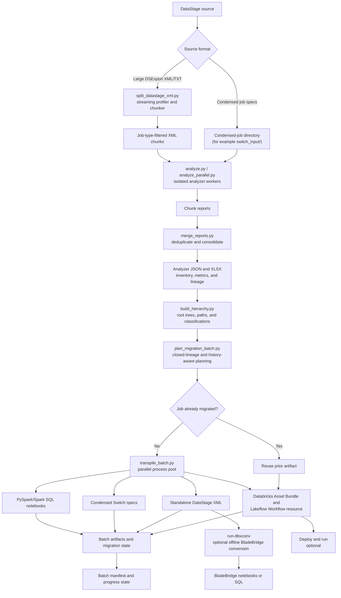

# Lakebridge workflow package

`lakebridge_workflow/` contains the end-to-end Lakebridge Analyzer, lineage, planning, and
migration workflow as an installable Python package. It is designed to work with:

- condensed DataStage job specifications, such as the files in `../switch_input/*.txt`
- a genuine large `DSExport` XML/TXT export when one is available
- a migration checkout containing the repository-specific compiler, bundles, and source exports

The package does not assume a fixed job count, hierarchy shape, complexity distribution, or
batch size.

## End-to-end workflow

The workflow supports two source entry points: condensed job specifications for an existing
repository checkout and a genuine large DataStage `DSExport` for a new migration assessment.
Both paths converge on the same analyzer, hierarchy, planning, and transpilation stages.



The exact artifacts and counts are derived from the selected source and lineage closure rather
than fixed in the workflow.

## Package layout

```text
lakebridge_workflow/
├── README.md
├── pyproject.toml
├── docs/lakebridge_analyzer_windows_guide-v6.md
├── scripts/run_dbxconv.ps1
├── src/lakebridge_workflow/
│   ├── __main__.py              # lakebridge-workflow CLI dispatcher
│   ├── workflow.py              # one-command end-to-end workflow
│   ├── common.py                # condensed-job parser and XLSX utilities
│   ├── paths.py                 # checkout discovery for installed wheel
│   ├── split_datastage_xml.py
│   ├── analyze.py
│   ├── analyze_parallel.py
│   ├── merge_reports.py
│   ├── build_hierarchy.py
│   ├── plan_migration_batch.py
│   ├── transpile_batch.py
│   └── run_dbxconv.py
└── dist/                        # built wheel artifacts
```

## Build the wheel

From the package folder:

```powershell
uv build --wheel --out-dir dist
```

From `migration/`:

```powershell
uv build --wheel --out-dir lakebridge_workflow/dist lakebridge_workflow
```

## Install and run

Select the newest wheel dynamically rather than referring to a fixed package version.

PowerShell:

```powershell
cd migration
$wheel = Get-ChildItem .\lakebridge_workflow\dist\*.whl |
  Sort-Object LastWriteTime -Descending |
  Select-Object -First 1

uv run --with $wheel.FullName lakebridge-workflow --version
```

Bash or Zsh:

```bash
cd migration
wheel="$(ls -t lakebridge_workflow/dist/*.whl | head -n 1)"

uv run --with "$wheel" lakebridge-workflow --version
```

Or install the selected wheel into an existing Python environment:

```powershell
python -m pip install $wheel.FullName
lakebridge-workflow --version
```

The package locates a migration checkout from the current directory or its parents. To point
to a checkout explicitly, set:

```powershell
$env:LAKEBRIDGE_MIGRATION_ROOT = "C:\path\to\repository\migration"
```

## One-command end-to-end workflow

The command runs four generic phases:

1. Analyzer assessment
2. Sequence-to-ETL hierarchy construction
3. Closed-lineage batch planning
4. Deterministic batch transpilation

Use `<target-new-items>` as the desired number of new migration items:

```powershell
cd migration
$wheel = Get-ChildItem .\lakebridge_workflow\dist\*.whl |
  Sort-Object LastWriteTime -Descending |
  Select-Object -First 1

uv run `
  --with $wheel.FullName `
  lakebridge-workflow workflow `
  --num-jobs <target-new-items> `
  --transpile-workers <transpiler-worker-count> `
  --reset-history `
  --overwrite
```

Preview assessment, hierarchy, and the batch plan without changing migration state:

```powershell
lakebridge-workflow workflow --plan-only
```

A selected root sequence is always migrated with its full descendant closure. If the first
root closure is larger than `<target-new-items>`, the planner keeps the complete tree instead
of cutting it in half.

Parallel transpilation is controlled with `<transpiler-worker-count>`. Use `0` to select an
automatic count bounded by available CPUs and the number of selected jobs. Each worker
process independently compiles one job's notebook, copies its Switch specification, and
creates its standalone XML. Workflow generation and migration-state updates remain
single-writer operations.

The generated batch directory contains artifacts derived from the selected lineage:

- compiled PySpark/Spark SQL notebooks for selected parallel jobs
- a Lakeflow Workflow resource for the selected root sequence
- condensed Switch input specifications for newly migrated jobs
- standalone DataStage XML files when source DSX files are available
- support notebooks required by the source sequence
- a Databricks Asset Bundle
- `manifest.json`, `batch_summary.csv`, and updates to `migration_state.json`

## Individual commands

After installing the wheel, the tools are available through one CLI:

```powershell
lakebridge-workflow analyze --list-tech
lakebridge-workflow analyze --source-directory <condensed-or-xml-source> --report-file <report-prefix>.xlsx --source-tech Datastage --generate-json
lakebridge-workflow build-hierarchy --input-json <report-prefix>.json --out-prefix <hierarchy-prefix>
lakebridge-workflow plan --num-jobs <target-new-items> --dry-run
lakebridge-workflow transpile `
  --num-jobs <target-new-items> `
  --workers <transpiler-worker-count> `
  --reset-history `
  --overwrite
lakebridge-workflow plan --status
```

Equivalent module form is also supported:

```powershell
python -m lakebridge_workflow analyze --list-tech
python -m lakebridge_workflow workflow --plan-only
```

## Generated assessment

The consolidated report computes its values from the selected source at runtime. It includes:

- total unique items
- total nodes
- counts by job type
- counts by complexity level
- sequence-to-job links
- root-to-leaf lineage paths
- transformations, parameters, expressions, attributes, and embedded SQL when available

The exact numbers depend on the source export or condensed-job directory passed to the CLI.

## Large-export workflow

When a large DataStage export is available, profile it first:

```powershell
lakebridge-workflow split <export-file> --profile-only
```

Split sequence and ETL jobs into independently analyzable chunks:

```powershell
lakebridge-workflow split <export-file> `
  --out-dir <sequence-chunks-dir> `
  --jobs-per-file <jobs-per-chunk> `
  --only-job-type <job-type>

lakebridge-workflow split <export-file> `
  --out-dir <etl-chunks-dir> `
  --jobs-per-file <jobs-per-chunk> `
  --exclude-job-type <job-type> `
  --skip-table-defs
```

Analyze chunks with isolated workers:

```powershell
lakebridge-workflow analyze-parallel `
  --chunks-dir <chunks-dir> `
  --out-dir <worker-reports-dir> `
  --merge-prefix <merged-report-prefix> `
  --workers <worker-count> `
  --generate-json
```

`analyze` automatically uses the official `databricks-bb-analyzer` console script when it is
on `PATH`. For a nonstandard launcher, pass its command through `--external-command`:

```powershell
lakebridge-workflow analyze-parallel `
  --chunks-dir <chunks-dir> `
  --out-dir <worker-reports-dir> `
  --merge-prefix <merged-report-prefix> `
  --workers <worker-count> `
  --generate-json `
  --external-command '"<analyzer-executable>" --source-directory {source} --report-file {report} --source-tech Datastage --generate-json'
```

Combine report directories without rerunning workers:

```powershell
lakebridge-workflow merge-reports `
  --reports-dir <sequence-worker-reports-dir> `
  --reports-dir <etl-worker-reports-dir> `
  --out-prefix <merged-report-prefix>
```

The official technology name remains case-sensitive: `Datastage` (capital `D`, lowercase `s`).

## Offline BladeBridge conversion

Unpack the BladeBridge plugin into a local plugin directory, then convert either an XML
folder or a single XML file:

```powershell
lakebridge-workflow run-dbxconv `
  <plugin-dir> `
  <xml-source-or-dir> `
  <output-dir> `
  <PYSPARK|SPARKSQL|DBSQL>
```

On Windows, use the wrapper:

```powershell
.\scripts\run_dbxconv.ps1 `
  -XmlPath <xml-source-or-dir> `
  -OutputDir <output-dir> `
  -Target <PYSPARK|SPARKSQL|DBSQL> `
  -PluginDir <plugin-dir>
```

## Validation

The package is validated by:

- compiling all Python modules
- installing the built wheel into a clean virtual environment
- checking the installed `lakebridge-workflow` entry point
- listing the supported source technology
- running the complete workflow against a disposable migration checkout and output directory
