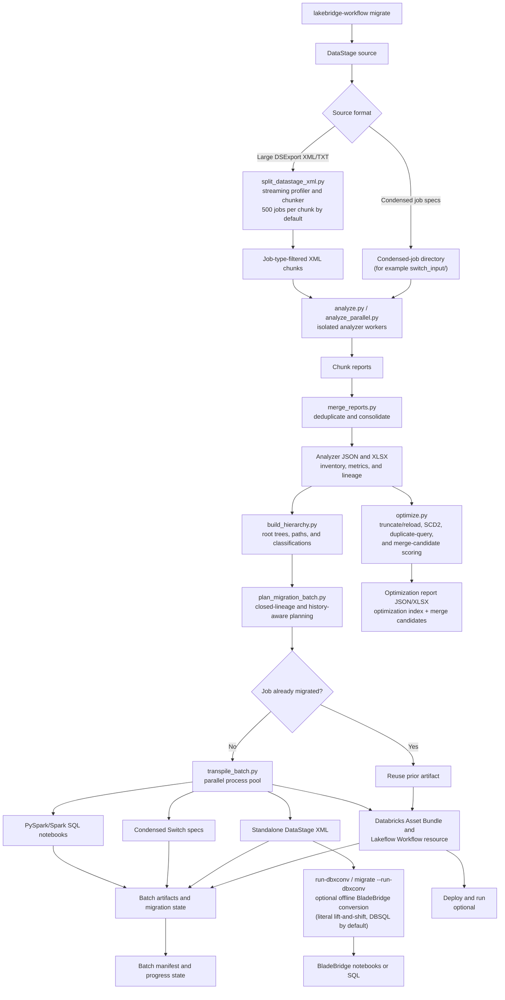

# Lakebridge workflow package

`lakebridge_workflow/` contains the end-to-end Lakebridge Analyzer, lineage, planning, and
migration workflow as an installable Python package. It is designed to work with:

- condensed DataStage job specifications, such as the files in `../switch_input/*.txt`
- a genuine large `DSExport` XML/TXT export when one is available
- a migration checkout containing the repository-specific compiler, bundles, and source exports

The package does not assume a fixed job count, hierarchy shape, complexity distribution, or
batch size.

## End-to-end workflow

The workflow supports two source entry points: condensed job specifications for an existing
repository checkout and a genuine large DataStage `DSExport` for a new migration assessment.
Both paths converge on the same analyzer, hierarchy, planning, and transpilation stages.



The exact artifacts and counts are derived from the selected source and lineage closure rather
than fixed in the workflow.

## Package layout

```text
lakebridge_workflow/
├── README.md
├── pyproject.toml
├── docs/lakebridge_analyzer_windows_guide-v6.md
├── scripts/run_dbxconv.ps1
├── src/lakebridge_workflow/
│   ├── __main__.py              # lakebridge-workflow CLI dispatcher
│   ├── workflow.py              # one-command end-to-end workflow
│   ├── common.py                # condensed-job parser and XLSX utilities
│   ├── paths.py                 # checkout discovery for installed wheel
│   ├── split_datastage_xml.py
│   ├── analyze.py
│   ├── analyze_parallel.py
│   ├── merge_reports.py
│   ├── build_hierarchy.py
│   ├── optimize.py             # truncate/reload, SCD2, duplicate-query, merge-candidate report
│   ├── migrate.py
│   ├── plan_migration_batch.py
│   ├── transpile_batch.py
│   └── run_dbxconv.py
└── dist/                        # built wheel artifacts
```

## Build the wheel

The package uses the built-in `uv_build` backend. It does not declare or download a
`setuptools` build dependency.

From the package folder:

```powershell
uv build --wheel --out-dir dist
```

From `migration/`:

```powershell
uv build --wheel --out-dir lakebridge_workflow/dist lakebridge_workflow
```

The checked-in wheel is generated by `uv 0.9.5`; its `WHEEL` metadata reports:

```text
Generator: uv 0.9.5
```

## Install and run

Select the newest wheel dynamically rather than referring to a fixed package version.

PowerShell:

```powershell
cd migration
$wheel = Get-ChildItem .\lakebridge_workflow\dist\*.whl |
  Sort-Object LastWriteTime -Descending |
  Select-Object -First 1

uv run --with $wheel.FullName lakebridge-workflow --version
```

Bash or Zsh:

```bash
cd migration
wheel="$(ls -t lakebridge_workflow/dist/*.whl | head -n 1)"

uv run --with "$wheel" lakebridge-workflow --version
```

Or install the selected wheel into an existing Python environment:

```powershell
python -m pip install $wheel.FullName
lakebridge-workflow --version
```

The package locates a migration checkout from the current directory or its parents. To point
to a checkout explicitly, set:

```powershell
$env:LAKEBRIDGE_MIGRATION_ROOT = "C:\path\to\repository\migration"
```

## Prerequisites

The package separates the Python Analyzer command from the native BladeBridge converter.

| Component | How it is provided | Required for | Interface |
|---|---|---|---|
| Lakebridge workflow package | Built and installed from `dist/*.whl` | All commands | `lakebridge-workflow` |
| `databricks-bb-analyzer` | Installed into the same `uv`/Python environment | Official analysis of XML `DSExport` chunks | Console command `databricks-bb-analyzer` on `PATH`, or `--external-command` |
| `databricks-bb-plugin` | Manually downloaded and unpacked | Optional offline `dbxconv` conversion | Extracted plugin folder passed to `run-dbxconv --plugin-dir`, or `migrate --run-dbxconv --dbxconv-plugin-dir` |

### Analyzer prerequisite

The Analyzer is a normal Python package. It does **not** use a folder flag. Install it into
the same ephemeral `uv` environment as the workflow wheel:

```powershell
uv run `
  --with ./lakebridge_workflow/dist/<wheel-file> `
  --with "databricks-bb-analyzer~=0.3.0,!=0.3.1" `
  lakebridge-workflow migrate `
  --source <DSExport-or-condensed-source> `
  --num-jobs <target-new-items>
```

The workflow discovers `databricks-bb-analyzer` on `PATH`. For a nonstandard launcher, use:

```text
--external-command "<analyzer-executable> --source-directory {source} --report-file {report} --source-tech Datastage --generate-json"
```

### BladeBridge plugin prerequisite

The BladeBridge plugin is **not installed automatically** by this package. It is needed only
when you run offline `dbxconv` conversion, either separately through `run-dbxconv` or through
`migrate --run-dbxconv`.

The plugin wheel contains a native `dbxconv` binary and its converter configuration tree.
Unpack it once into a local folder, for example:

```powershell
python -m zipfile -e <databricks_bb_plugin-wheel-file> bb_plugin
```

Then pass that folder to the converter command:

```powershell
uv run --python 3.12 `
  --with ./lakebridge_workflow/dist/<wheel-file> `
  lakebridge-workflow run-dbxconv `
  --plugin-dir bb_plugin `
  <xml-source-or-dir> `
  <output-dir> `
  <PYSPARK|SPARKSQL|DBSQL>
```

BladeBridge's native runtime supports Python 3.10–3.14; Python 3.12 is the recommended
offline runner.

By default, `migrate` stops after deterministic transpilation and does **not** invoke
`dbxconv`. Supply `--run-dbxconv` to extend the same command through offline BladeBridge
conversion.

## One-command migration workflow

Use `migrate` to run the complete workflow from either a large `DSExport` file or a
condensed-job directory. For a `DSExport`, the command automatically:

1. Splits sequence and ETL jobs into XML chunks
2. Analyzes the chunks in parallel
3. Merges the reports
4. Builds the job hierarchy
5. Scores optimization opportunities (truncate/reload writes, hand-rolled SCD2, duplicate
   queries, missing filters) and merge candidates
6. Plans a closed-lineage batch
7. Transpiles the batch in parallel
8. Optionally runs offline BladeBridge conversion when `--run-dbxconv` is supplied

`dbxconv` (step 8) stays a literal lift-and-shift: it converts each job stage by stage
with no re-architecture. The optimization report (step 5) is the only place this workflow
suggests re-architecting anything, and it never changes what `dbxconv` or the deterministic
transpiler produce.

### Required flags

| Flag | Value |
|---|---|
| `--source` | Large `DSExport` XML/TXT file or condensed-job directory |
| `--num-jobs` | Target number of new migration items |

The minimal command is:

```powershell
lakebridge-workflow migrate `
  --source <DSExport-or-condensed-source> `
  --num-jobs <target-new-items>
```

### Optional flags and defaults

| Flag | Default | Purpose |
|---|---|---|
| `--jobs-per-file` | `500` | Jobs per XML chunk when splitting a `DSExport` |
| `--workers` | Omitted; one worker per XML chunk | Analyzer workers. A lower explicit count distributes chunks across those workers |
| `--transpile-workers` | Omitted; one worker per selected job | Transpiler workers. A lower explicit count distributes jobs across those workers |
| `--analysis-dir` | `<migration-root>/lakebridge_workflow_analysis` | Directory for chunks, worker reports, merged report, and hierarchy |
| `--state-file` | `<migration-root>/migration_state.json` | Migration history file |
| `--output-root` | `<migration-root>/migrated_batches` | Root directory for generated batches |
| `--filter` | No filter | Optional root-name or folder substring filter |
| `--external-command` | Discover `databricks-bb-analyzer` on `PATH` | Official analyzer command with `{source}`, `{report}`, and `{json}` placeholders |
| `--reset-history` | `false` | Start from an empty migration state |
| `--overwrite` | `false` | Replace an existing batch output directory |
| `--plan-only` | `false` | Stop after the dry-run batch plan |
| `--no-xml` | `false` | Skip standalone XML copies; notebooks are still generated |
| `--run-dbxconv` | `false` | Run offline BladeBridge conversion after deterministic transpilation |
| `--dbxconv-plugin-dir` | `bb_plugin` | Manually unpacked `databricks_bb_plugin` wheel root; used only with `--run-dbxconv` |
| `--dbxconv-target` | `DBSQL` | BladeBridge target: `PYSPARK`, `SPARKSQL`, or `DBSQL` |
| `--dbxconv-output-dir` | `<batch-dir>/bladebridge_<target>` | BladeBridge output directory; used only with `--run-dbxconv` |

Common path, chunking, worker, and analyzer overrides are:

```powershell
lakebridge-workflow migrate `
  --source <DSExport-or-condensed-source> `
  --num-jobs <target-new-items> `
  --jobs-per-file <jobs-per-chunk> `
  --workers <analyzer-worker-count> `
  --transpile-workers <transpiler-worker-count> `
  --analysis-dir <analysis-dir> `
  --state-file <state-file> `
  --output-root <batch-output-root> `
  --filter <root-or-folder-filter> `
  --external-command "<analyzer-command-with-placeholders>"
```

Behavior flags are used individually, according to the run mode:

```powershell
# Preview assessment, hierarchy, and the closed-lineage plan without transpiling.
--plan-only

# Start a fresh migration history and replace an existing batch directory.
--reset-history --overwrite

# Generate notebooks and workflow but skip standalone XML copies.
--no-xml

# Also run offline BladeBridge conversion after deterministic transpilation.
--run-dbxconv `
--dbxconv-plugin-dir <bb-plugin-dir> `
--dbxconv-target <PYSPARK|SPARKSQL|DBSQL> `
--dbxconv-output-dir <bladebridge-output-dir>
```

If an official analyzer is not on `PATH`, pass its launcher through
`--external-command`. The command accepts the same `{source}`, `{report}`, and `{json}`
placeholders used by `analyze-parallel`.

Generated chunk and report subdirectories under `<analysis-dir>` are recreated on each run so
stale files from a previous export cannot enter the new analysis. Use a different
`<analysis-dir>` if you need to preserve a previous analysis run.

## One-command condensed workflow

The `workflow` command is a shortcut for an existing condensed-job checkout. It runs four
generic phases:

1. Analyzer assessment
2. Sequence-to-ETL hierarchy construction
3. Closed-lineage batch planning
4. Deterministic batch transpilation

Use `<target-new-items>` as the desired number of new migration items:

```powershell
cd migration
$wheel = Get-ChildItem .\lakebridge_workflow\dist\*.whl |
  Sort-Object LastWriteTime -Descending |
  Select-Object -First 1

uv run `
  --with $wheel.FullName `
  lakebridge-workflow workflow `
  --num-jobs <target-new-items> `
  --transpile-workers <transpiler-worker-count> `
  --reset-history `
  --overwrite
```

Preview assessment, hierarchy, and the batch plan without changing migration state:

```powershell
lakebridge-workflow workflow --plan-only
```

A selected root sequence is always migrated with its full descendant closure. If the first
root closure is larger than `<target-new-items>`, the planner keeps the complete tree instead
of cutting it in half.

Parallel transpilation is controlled with `<transpiler-worker-count>`. When omitted, the
workflow uses one worker per selected job. If a lower explicit count is supplied, jobs are
distributed across those workers. Each worker process independently compiles one job's
notebook, copies its Switch specification, and creates its standalone XML. Workflow
generation and migration-state updates remain single-writer operations.

The generated batch directory contains artifacts derived from the selected lineage:

- compiled PySpark/Spark SQL notebooks for selected parallel jobs
- a Lakeflow Workflow resource for the selected root sequence
- condensed Switch input specifications for newly migrated jobs
- standalone DataStage XML files when source DSX files are available
- support notebooks required by the source sequence
- a Databricks Asset Bundle
- `manifest.json`, `batch_summary.csv`, and updates to `migration_state.json`

## Individual commands

After installing the wheel, the tools are available through one CLI:

```powershell
lakebridge-workflow analyze --list-tech
lakebridge-workflow analyze --source-directory <condensed-or-xml-source> --report-file <report-prefix>.xlsx --source-tech Datastage --generate-json
lakebridge-workflow build-hierarchy --input-json <report-prefix>.json --out-prefix <hierarchy-prefix>
lakebridge-workflow optimize --input-json <report-prefix>.json --out-prefix <optimization-report-prefix>
lakebridge-workflow plan --num-jobs <target-new-items> --dry-run
lakebridge-workflow transpile `
  --num-jobs <target-new-items> `
  --workers <transpiler-worker-count> `
  --reset-history `
  --overwrite
lakebridge-workflow plan --status
```

Equivalent module form is also supported:

```powershell
python -m lakebridge_workflow analyze --list-tech
python -m lakebridge_workflow workflow --plan-only
```

## Generated assessment

The consolidated report computes its values from the selected source at runtime. It includes:

- total unique items
- total nodes
- counts by job type
- counts by complexity level
- sequence-to-job links
- root-to-leaf lineage paths
- transformations, parameters, expressions, attributes, and embedded SQL when available

The exact numbers depend on the source export or condensed-job directory passed to the CLI.

## Optimization report

`optimize` runs a second, independent scoring pass over the same consolidated JSON
`build-hierarchy` consumes. It does not touch `dbxconv` or the deterministic transpiler;
both stay a literal lift-and-shift. It looks for four known DataStage-to-Databricks wins:

| Finding | What it looks for | The Databricks win |
|---|---|---|
| Truncate-and-reload writes | A target stage whose write mode is a full overwrite/truncate/replace | `MERGE` or Auto CDC instead of a full rewrite every run |
| Hand-rolled SCD2 / change-detection | A Join between a snapshot and the current state, branching by hand into expire/carry/new-version logic | `create_auto_cdc_from_snapshot_flow` -- this repository's own SCD2 job (`migration/README.md` §7) is the worked example |
| Duplicate queries | The same embedded SQL statement, filter predicate, or derivation expression repeated across jobs | Factor into one shared view, macro, or parameterized job |
| Filters pushed too late | A join/lookup/aggregation with no filter stage anywhere in the job, or embedded SQL with no `WHERE` | Push the predicate before the expensive stage |

Each job gets an **optimization index** score and a HIGH/MEDIUM/LOW band, the same shape
as the Analyzer's own complexity index, so the two reports read side by side: complexity
says how hard a job is to migrate, the optimization index says how worth re-architecting
it is once it lands. Duplicate-logic groups that span two or more jobs are also listed
separately as **merge candidates** -- the specific jobs sharing the duplicated logic, and
a suggested consolidation.

```powershell
lakebridge-workflow optimize --input-json <report-prefix>.json --out-prefix optimization_report
```

Output: `optimization_report.json` / `.xlsx` with a `Summary`, `Optimization Index`,
`Truncate-Reload Writes`, `SCD2 Candidates`, `Duplicate Queries`, `Queries Without
Filters`, and `Merge Candidates` tab. `migrate` and `workflow` run it automatically
(no extra flag) right after the hierarchy build.

## Large-export workflow

When a large DataStage export is available, profile it first:

```powershell
lakebridge-workflow split <export-file> --profile-only
```

Split sequence and ETL jobs into independently analyzable chunks:

```powershell
lakebridge-workflow split <export-file> `
  --out-dir <sequence-chunks-dir> `
  --jobs-per-file <jobs-per-chunk> `
  --only-job-type <job-type>

lakebridge-workflow split <export-file> `
  --out-dir <etl-chunks-dir> `
  --jobs-per-file <jobs-per-chunk> `
  --exclude-job-type <job-type> `
  --skip-table-defs
```

Analyze chunks with isolated workers. By default, the runner uses one worker per XML chunk. If a lower explicit worker count is supplied, chunks are distributed across those workers:

```powershell
lakebridge-workflow analyze-parallel `
  --chunks-dir <chunks-dir> `
  --out-dir <worker-reports-dir> `
  --merge-prefix <merged-report-prefix> `
  --workers <worker-count> `
  --generate-json
```

`analyze` automatically uses the official `databricks-bb-analyzer` console script when it is
on `PATH`. For a nonstandard launcher, pass its command through `--external-command`:

```powershell
lakebridge-workflow analyze-parallel `
  --chunks-dir <chunks-dir> `
  --out-dir <worker-reports-dir> `
  --merge-prefix <merged-report-prefix> `
  --workers <worker-count> `
  --generate-json `
  --external-command '"<analyzer-executable>" --source-directory {source} --report-file {report} --source-tech Datastage --generate-json'
```

Combine report directories without rerunning workers:

```powershell
lakebridge-workflow merge-reports `
  --reports-dir <sequence-worker-reports-dir> `
  --reports-dir <etl-worker-reports-dir> `
  --out-prefix <merged-report-prefix>
```

The official technology name remains case-sensitive: `Datastage` (capital `D`, lowercase `s`).

## Offline BladeBridge conversion

`run-dbxconv` is a literal lift-and-shift: it converts each job stage by stage with no
re-architecture. For optimization opportunities, run `optimize` separately; it reads the
same analyzer report and never changes what this converter produces.

Unpack the BladeBridge plugin into a local plugin directory, then convert either an XML
folder or a single XML file. The target defaults to `DBSQL` (a plain Databricks SQL
script) when `--target`/the positional target is omitted; `PYSPARK` and `SPARKSQL`
notebooks are also available:

```powershell
lakebridge-workflow run-dbxconv `
  <plugin-dir> `
  <xml-source-or-dir> `
  <output-dir> `
  <DBSQL|PYSPARK|SPARKSQL>
```

On Windows, use the wrapper:

```powershell
.\scripts\run_dbxconv.ps1 `
  -XmlPath <xml-source-or-dir> `
  -OutputDir <output-dir> `
  -Target <PYSPARK|SPARKSQL|DBSQL> `
  -PluginDir <plugin-dir>
```

## Validation

The package is validated by:

- compiling all Python modules
- installing the built wheel into a clean virtual environment
- checking the installed `lakebridge-workflow` entry point
- listing the supported source technology
- running the complete workflow against a disposable migration checkout and output directory
